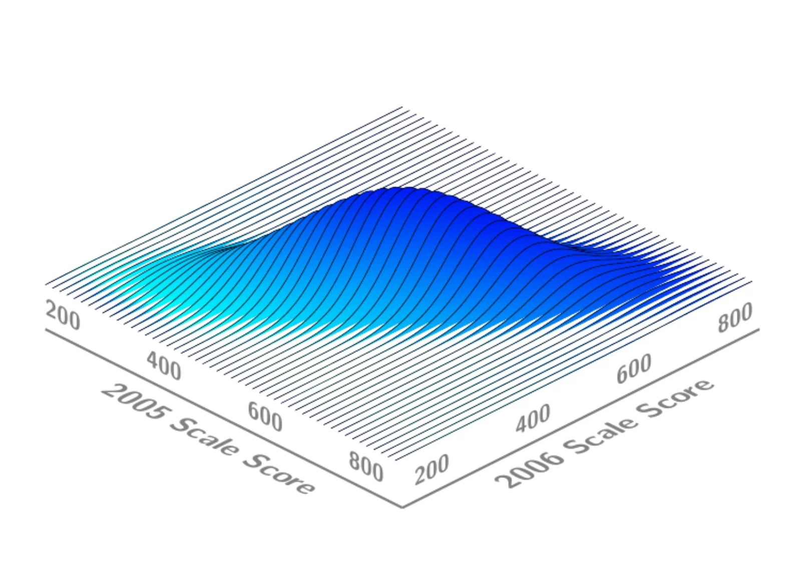
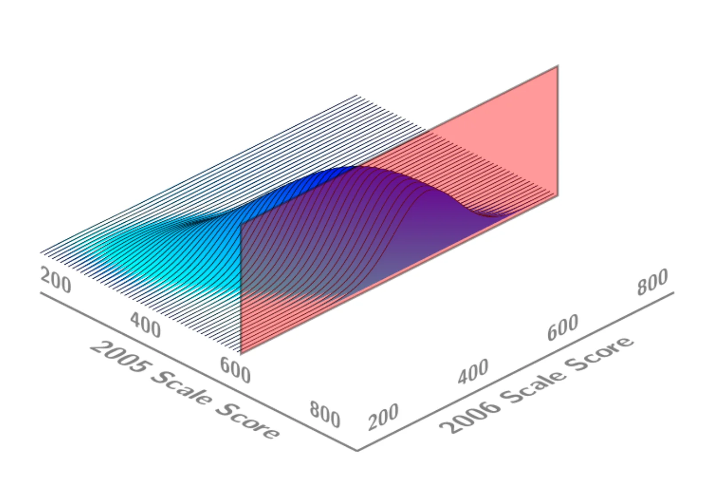
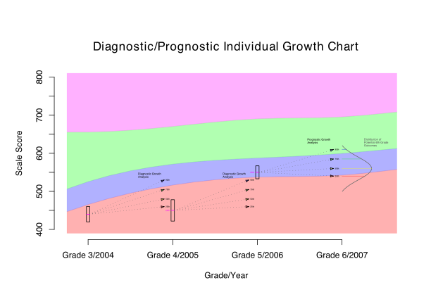

## Accountability Models

-   Accountability mandates---like NCLB's universal proficiency requirement---dominate discussions of assessment outcomes.

-   Despite their prominence, it is important distinguish between the judgments made by the accountability system and the assessment derived quantities on which the judgment is based.

-   Accountability systems provide/impose values that allow judgments to be made about performance at the individual or aggregate level.

    -   A school might report 55% of its students proficient in math. Judging this result as (in)adequate requires separate values, usually embedded within an accountability system.

    -   Similarly, a student scoring 500 on the grade 5 CSAP reading test is judged *unsatisfactory* by the values embedded within the performance standards and accountability system.

-   With the analysis of growth, it is important to distinguish between the description of growth provided by the model and the qualification of that value as (in)adequate by the accountability system.

## Growth Models

-   Over the last decade, growth models have been used primarily to infer effectiveness at the teacher or school level.

-   The foremost example being the **[value-added models]{.accent}** developed by Dr. William Sanders and used in many districts and states nationwide to infer teacher or school effectiveness

-   These models and their effectiveness claims are controversial for a number of reasons [@Braun:2005; @RubiStua:2004].

-   Value-added models provide normative "effectiveness" quantities that are difficult to interpret.

-   The models provide a means for accountability systems to judge without providing a description of growth.

## Growth Models and Implicit Values

-   Value-added models implicitely judge effectiveness based upon whether teachers or schools significantly differ from mathemtically derived expectation (i.e., "average").

-   In this context, the average for a teacher of school is judged to be neutral, significantly above average---good, and significantly below---average bad.

-   Current **[growth to a standard]{.accent}** methodologies implicitely judge individual student progress based upon whether growth is sufficient to achieve/maintain proficient status within a number of years.

-   Neither value-added nor growth to a standard models supply a useful description of effectiveness/growth beyond the judgment of (in)adequacy.

-   Growth models incorporated into accountability systems should return actionable descriptions of growth/effectiveness that allow stakeholders to more transparently impose their own values of (in)adequacy.

## Actual versus Aspirational Student Growth

-   It seems simple enough: Establish what constitutes a year's growth in a year's time for each student.

-   This simplicity belies a subtle complexity.

-   To adequately address the notion of a year's growth, **[actual]{.accent}** growth must be distinguished from **[aspirational]{.accent}** growth.

    Describe

    :   What **[is]{.accent}** a current year's growth?

    Prescribe

    :   What **[should]{.accent}** a current year's growth be?

-   Answering the second question establishes a threshold distinguishing adequate from inadequate growth.

-   To make such a distinction requires an answer to the first question which defines a norm: What is the range of growth currently observed?

-   Aspirational growth should be possible---This is Linn's existence proof applied at the individual level [@Linn:2003a].

## Describing Actual Student Growth

-   Measuring student growth, even with a vertical scale, is not a simple task.

-   Numerous States believe that placing their tests on a vertical scale will simplify the task of measuring student growth.

-   Even with an interval (or ratio) scale, growth is not easy to interpret. Consider, for example, height.

    -   A child might grow 4 inches between ages 3 and 4.

    -   4 inches is a well understood quantity.

    -   However, the 4 inch increase becomes fully understandable only when placed in context of growth of other children between ages 3 and 4.

-   In the following discussion **[student growth percentiles]{.accent}** are introduced that provide a normative context to interpret student growth.

## Joint Distribution of 2005 and 2006 Scale Scores {.figure-slide}

{fig-alt="Three-dimensional surface plot of the joint density of students' 2005 and 2006 scale scores, each axis running from about 200 to 800. The density forms a single ridge along the diagonal: students with higher 2005 scores tend to have higher 2006 scores."}

## Conditioning on a 2005 Scale Score {.figure-slide}

{fig-alt="The same joint density surface cut by a red vertical plane at a single 2005 scale score (near 600), isolating the students who share that prior score."}

## Conditional Distribution of 2006 Scale Scores {.figure-slide}

{fig-alt="The slice of the density surface along the red plane is traced as a red curve: the distribution of 2006 scale scores for students with the same 2005 scale score."}

## Locating a Student's 2006 Score {.figure-slide}

{fig-alt="A dashed pink line marks one student's 2006 scale score on the red conditional distribution, showing where that score falls among students with the same 2005 score."}

## Student Growth Percentiles

-   As the figures indicate, there is a distribution of 2006 scale scores associated with each 2005 scale score.

-   The average (or median) of the conditional density could be used as a point estimate of the expected 2006 scale score given the student's 2005 performance.

-   Similarly, the middle 50% of each density gives a range of scores where one would expect such a student's score to reside 50% of the time.

-   Using quantile regression techniques, conditional densities using more than a single prior score can be estimated.

-   Given a student's prior scale scores and the associated conditional density, their current scale score corresponds to a percentile of that conditional distribution.

-   This percentile is the **[student's growth percentile]{.accent}**.

-   For example, a student growth percentile of 60 indicates the student's latest scale score exceeded 60 percent of his/her counterparts with equal prior scores.

## Student Growth Percentiles

-   Student growth percentiles norm each student's growth relative to similarly performing students.

-   The growth percentiles are estimated using quantile regression techniques (Betebenner & Shang, 2007; Koenker, 2005).

-   The percentile scale on which the growth percentiles lie allows for easy comparison of all students.

-   For example, consider a low achieving student demonstrating 90th percentile growth and a high achieving student demonstrating 10th percentile growth.

    -   The low achieving student grew at a rate exceeding 90 percent of similar students.

    -   The high achieving student grew at a rate exceeding just 10 percent of similar students.

    -   In this sense, the low achiever's growth is more *extraordinary* than the high achiever's.

-   However, judgment of whether the student's growth was **[adequate]{.accent}** requires external criteria.

## Performance Standards and Growth Percentiles

-   Performance standards are the most useful external criteria needed to define what adequate growth is.

-   If proficiency within 3 years is the achievement goal, then one can examine prior growth to estimate what growth percentile is sufficient to reach the desired outcome.

-   For high achieving students, modest growth percentiles are required to maintain their position above proficiency in reading.

-   For low achieving (low unsatisfactory) students in reading, sustained 80th percentile growth is required to reach the desired threshold.

-   The process of defining (in)adequate growth is a **[standard setting procedure]{.accent}**.

-   Clearly, defining a year's growth for some students as 80th percentile or better sets a very high standard.

-   And defining a year's growth for some students as 25th percentile or better sets a low standard.

-   Growth standards should be **[equitable]{.accent}**, **[reasonable]{.accent}**, and **[desirable]{.accent}**.

## Combining Actual and Aspirational Growth

-   Using student growth percentiles it is simple to reconcile actual growth measures with aspirational growth targets.

-   Each student receives a growth percentile derived from present performance conditioning upon past performance.

-   Growth standard setting is conducted once to determine what growth percentiles will be considered adequate and what growth percentiles will be considered inadequate.

-   For example, consider a student just completing the 5th grade

    -   Their reading was at the partially proficient level.

    -   However, considering their 3rd and 4th grade achievement, they grew in the last year at the 99th percentile.

    -   Moreover, that level of growth is deemed adequate---they made at least a year's growth.

-   The following figure depicts this student's scenario.

## Diagnostic/Prognostic Individual Growth Chart {.figure-slide}

{fig-align="center" fig-alt="Individual growth chart of scale score (400 to 800) by grade and year, from Grade 3/2004 to Grade 6/2007, over four colored achievement-level bands. The student's scores in grades 3, 4 and 5 are marked with boxes; dotted fans of 25th to 90th percentile growth paths from each score form the diagnostic growth analysis, and a fan into grade 6 with a curve of potential 6th grade outcomes forms the prognostic growth analysis."}

## Ethics and Growth Standards

:::: {.columns}
::: {.column width="32%"}
::: {style="text-align: center;"}
**Hume**

{height="560px" fig-alt="Portrait of the philosopher David Hume."}

**Is/Ought Fallacy**
:::
:::

::: {.column width="32%"}
::: {style="text-align: center;"}
**Kant**

{height="560px" fig-alt="Portrait of the philosopher Immanuel Kant."}

**Ought Implies Can**
:::
:::

::: {.column width="32%"}
::: {style="text-align: center;"}
**Linn**

{height="560px" fig-alt="Photograph of the educational measurement scholar Robert Linn."}

**Existence Proof**
:::
:::
::::

## Ethics and Accountability

-   Growth percentiles easily translate to probability statements and make transparent the possibility of achievement outcomes conditional upon where a student begins.

-   Given current mandates to ammeliorate achievement gaps between ethnic and other subgroups, descriptive analyses of growth using growth percentiles present stark alternatives.

-   Uniform (and challenging) achievement goals for all subgroups results in higher---and in some cases unrealistic---growth standards/expectations.

-   Is doesn't imply ought, but ought should imply can. How can this moral dilemma be reconciled.

-   Norming results by subgroup (or covarying by some other demographic variable) is not an attractive alternative.

## References {.smaller .scrollable}

::: {#refs}
:::

