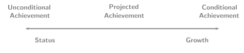

## Growth & Accountability

::: {.key-insight-box}
::: {.key-insight-box-title}
Bob's Axiom
:::

Scratch a criterion and you (should) find a norm.
:::

-   Accountability mandates---like NCLB's "bright line" (i.e., universal proficiency) requirements---dominate discussions of assessment outcomes.

-   In these discussions, it is important distinguish between the judgments made by the accountability system and the quantities on which the judgment is based.

-   With the analysis of growth, it is important to distinguish between a description of growth provided by the model and the qualification of that value as (in)adequate by the accountability system.

-   Growth-to-standard methodologies qualify, for accountability purposes, whether a student is on track to proficient and use this qualification as evidence of school quality.

-   These criterion referenced growth models define adequate growth without establishing a norm and thus are in violation of Bob's Axiom.

## Growth & Status

{fig-align="center" width="1300px" fig-alt="Diagram of a representational continuum: an arrow runs from Status on the left to Growth on the right, with Unconditional Achievement at the status end, Conditional Achievement at the growth end, and Projected Achievement in between."}

-   Current **[growth-to-standard]{.accent}** methodologies judge individual student progress based upon projections of future student achievement.

-   In this sense, growth-to-standard models are **[projected achievement]{.accent}** models.

-   Given the representational continuum connecting status with growth, growth-to-standard models are hybrids, neither growth nor status.

-   Not surprisingly, results derived from their use correlate highly with results derived from existing status models [@Dunn:2007].

## Actual versus Aspirational Student Growth

-   Conditional achievement (i.e., growth) models can serve the same ends as projected achievement/growth-to-standard models.

-   Doing so requires distinguishing **[actual]{.accent}** growth from **[aspirational]{.accent}** growth.

    Actual

    :   What **[is]{.accent}** a current year's growth?

    Aspirational

    :   What **[should]{.accent}** a current year's growth be?

-   Answering the second question establishes a threshold distinguishing adequate from inadequate growth.

-   To make such a distinction requires an answer to the first question which defines a norm: What is the range of growth currently observed?

-   Aspirational growth should be possible---*Ought implies Can* (Kant) or Linn's existence proof [@Linn:2003a].

## Describing Actual Student Growth

-   Measuring student growth, even with a vertical scale, is not a simple task.

-   Numerous states believe that placing their tests on a vertical scale will simplify the task of measuring student growth.

-   Even with an interval (or ratio) scale, growth is not easy to interpret. Consider, for example, height.

    -   A child might grow 4 inches between ages 3 and 4.

    -   4 inches is a well understood quantity.

    -   However, the 4 inch increase becomes fully understandable only when placed in context of growth of other children between ages 3 and 4.

-   The following introduces **[student growth percentiles]{.accent}** as a normative quantity useful to interpreting student growth.

## Student Growth Percentiles

-   A quantity of fundamental interest to norming student progress (i.e., conditional achievement) is:

    $$
    \Pr(Current~Achievement | Past~Achievement).
    $$ {#eq-condprob}

-   A **[student's growth percentile]{.accent}** is the conversion of @eq-condprob to a percentile.

-   Estimation of the conditional density used to calculate student growth percentiles is performed using quantile regression (Betebenner & Shang, 2007; Koenker, 2005).

-   Consider a low achieving student demonstrating 90th percentile growth and a high achieving student demonstrating 10th percentile growth.

    -   The low achieving student grew at a rate exceeding 90 percent of similar students.

    -   The high achieving student grew at a rate exceeding just 10 percent of similar students.

    -   In this sense, the low achiever's growth is more *exemplary* than the high achiever's.

-   Growth percentiles allow for easy understanding and comparison of student growth.

-   However, judgment of whether the student's growth was **[adequate]{.accent}** requires external criteria.

## Performance Standards and Growth Percentiles

-   Performance standards are the most obvious external criteria needed to define what adequate growth is.

-   If proficiency within 3 years is the achievement goal, then one can examine prior growth to estimate what growth percentile is sufficient to reach the desired outcome.

-   For high achieving students, modest growth percentiles are required to maintain their position above proficiency whereas for some low achieving student sustained high growth percentiles are necessary.

-   The process of defining (in)adequate growth is a **[standard setting procedure]{.accent}**.

-   Clearly, defining adequate growth for some students as 80th percentile or better sets a very high standard.

-   And defining a year's growth for some students as 25th percentile or better sets a low standard.

-   Growth standards should be **[equitable]{.accent}**, **[reasonable]{.accent}**, and **[desirable]{.accent}**.

## Achievement Projections/Forecasts

-   Growth-to-standard analyses project future student achievement and use these determinations for accountability purposes.

-   Such projections implicitly assume (but rarely explicate) interim rates of growth for the student.

-   The result of growth-to-standard analyses are almost fatalistic statements about the future status of students.

-   Such conversations often leave teachers/educators wondering what their role is if the student's future status is known.

-   Conversations about future status must turn from "where will (s)he be" to "what will it take".

-   Using student growth percentile estimation techniques it is possible to forecast different growth scenarios that allow stakeholders to entertain conversations of "what it will take".

-   These forecasts establish a basis for growth standard setting.

-   Only by considering **[what is]{.accent}**, **[what should be]{.accent}**, and **[what is possible]{.accent}** simultaneously, can growth models and their associated standards by equitable, just and truly informed.

## References {.smaller .scrollable}

::: {#refs}
:::

