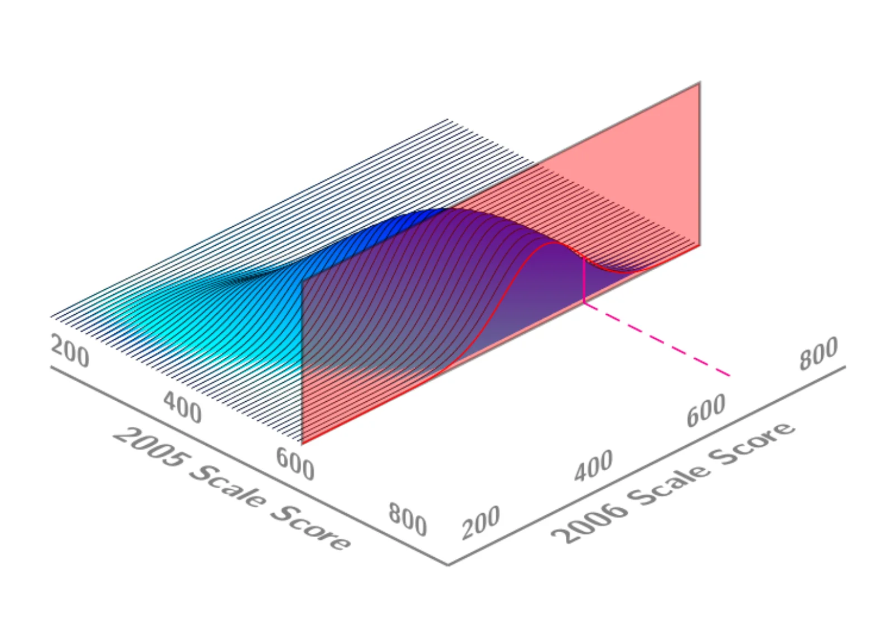
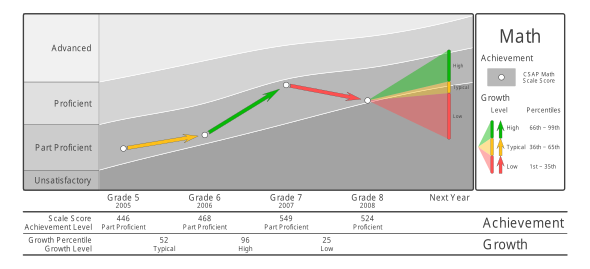
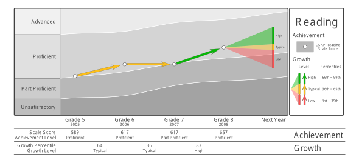
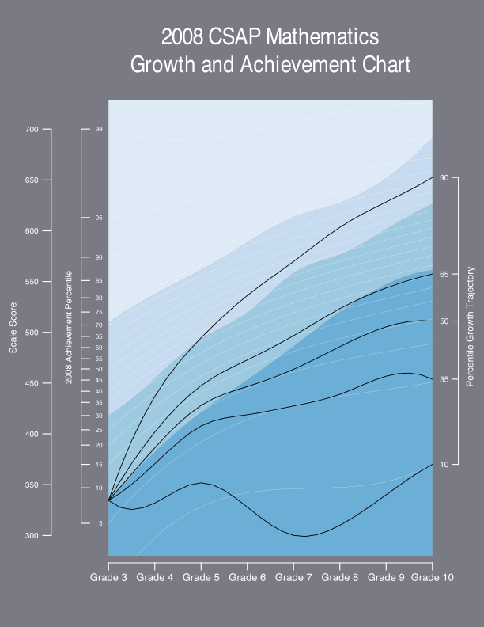
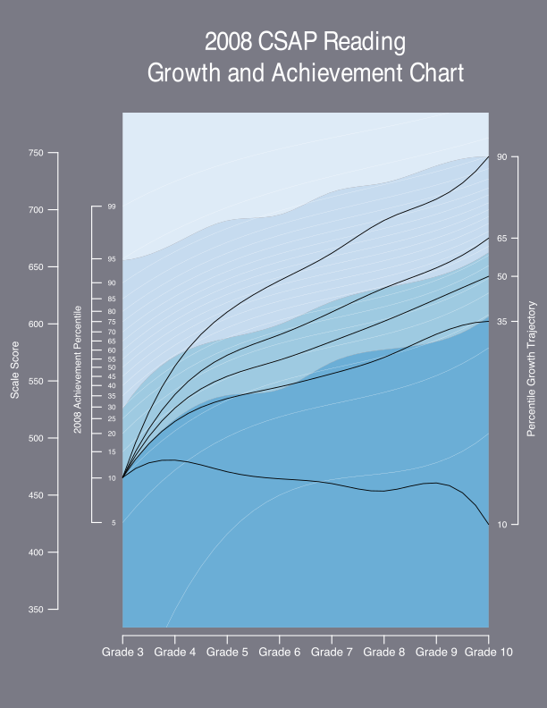
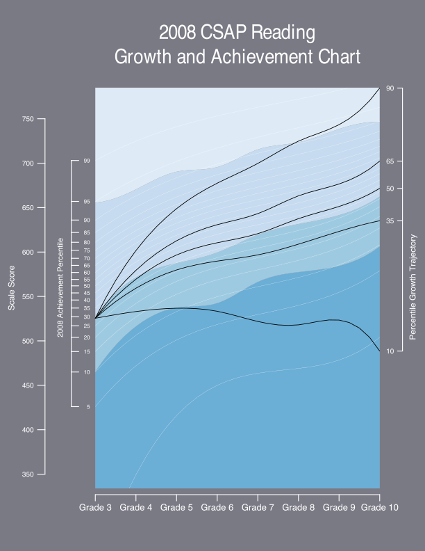

## Growth, Standards and Accountability

::: {style="text-align: center;"}
**[Growth, Standards, and Accountability:\
Dominant (and linked) themes in education today.]{.accent}**
:::

Growth

:   Examination of student achievement over time.

Standards

:   Broadly used to anchor judgments and qualifications of education quality.

Accountability

:   Currently focus on assignment of responsibility for performance (e.g., school accountability).

## Growth, Standards and Accountability

**[Is it possible to better connect these three themes?]{.accent}**

-   Angoff (1974): "Scratch a criterion and you find a norm"

-   Need BOTH norms and criteria to make sense of the world.

-   Normative growth is a lens that can illuminate a number of important relationships.

## Growth and Standards

-   What rates of student growth are necessary for students to reach desirable performance standards?

-   Are these rates of growth realistic for all students?

## Standards and Accountability

-   Given current performance standards, are universal performance (i.e., proficiency) mandates realistic?

-   What do we mean by "easy" and "hard" standards?

-   Can a balance between ambitious yet reasonable performance targets be struck?

## Growth and Accountability

-   What levels of institutional effectiveness are required to fulfill universal proficiency mandates?

-   Are these levels of effectiveness reasonable?

-   Is failure to reach these levels of effectiveness the sole responsibility of the education system?

## Describing Student Growth

-   Measuring student growth, even with a vertical scale, is not a simple task.

-   Even with an interval (or ratio) scale, growth is not easy to interpret. Consider, for example, height.

    -   A child might grow 4 inches between ages 3 and 4.

    -   4 inches is a well understood quantity.

    -   The 4 inch increase becomes really meaningful only when understood alongside the growth of other 3 to 4 year olds.

-   **[Student growth percentiles]{.accent}** were developed to provide a normative context for describing student growth.

## Joint Distribution of 2005 and 2006 Scale Scores {.figure-slide}

{fig-alt="Three-dimensional surface plot of the joint density of students' 2005 and 2006 scale scores, each axis running from about 200 to 800. The density forms a single ridge along the diagonal: students with higher 2005 scores tend to have higher 2006 scores."}

## Conditioning on a 2005 Scale Score {.figure-slide}

{fig-alt="The same joint density surface cut by a red vertical plane at a single 2005 scale score (near 600), isolating the students who share that prior score."}

## Conditional Distribution of 2006 Scale Scores {.figure-slide}

{fig-alt="The slice of the density surface along the red plane is traced as a red curve: the distribution of 2006 scale scores for students with the same 2005 scale score."}

## Locating a Student's 2006 Score {.figure-slide}

{fig-alt="A dashed pink line marks one student's 2006 scale score on the red conditional distribution, showing where that score falls among students with the same 2005 score."}

## Normative Growth Model

**[Should we be surprised with a child's current achievement given their prior achievement?]{.accent}**

$$
\Pr(Current~Achievement | Past~Achievement).
$$

-   Quantile regression is used to model the conditional quantile functions.

-   B-spline smoothing is applied to accommodate non-linearity, heteroscedasticity, etc. *Scatterplot Smoothing*

-   The method is a quantile regression based generalized additive model [@HastTibs:1990; @Wood:2006]

-   Implemented in R using SGP Package

## Normative and Criterion-Referenced Growth

**["Adequate" Growth: Is a student's (normative) growth sufficient to reach/maintain desired performance standards (e.g., proficiency)?]{.accent}**

-   Norms are blind to standards? Equally rare does not imply equally good.

-   Using the coefficient matrices from the quantile regression analyses, percentile growth projections/trajectories are calculated for each student.

-   These "growth-to-standard" trajectories indicate what it will take for the student to reach/maintain proficiency and other performance standards.

-   The Colorado Growth Model was recently approved as part of the Growth Model Pilot Program using this approach.

## Individual Growth and Achievement Report: Math {.figure-slide}

{fig-align="center" fig-alt="Individual student growth chart for Math, grade 5 (2005) to grade 8 (2008), over bands for Unsatisfactory, Part Proficient, Proficient and Advanced. Scale scores 446, 468, 549 and 524 rise from Part Proficient into Proficient, with growth percentiles of 52 (Typical), 96 (High) and 25 (Low); a fan of low, typical and high growth projections extends to next year."}

## Individual Growth and Achievement Report: Reading {.figure-slide}

{fig-align="center" fig-alt="Individual student growth chart for Reading, grade 5 (2005) to grade 8 (2008). Scale scores 589, 617, 617 and 657 stay mostly in Proficient (Part Proficient in grade 7), with growth percentiles of 64 (Typical), 36 (Typical) and 83 (High); a fan of low, typical and high growth projections extends to next year."}

## An even bigger picture

-   The education system, being composed of students, can be examined similarly.

-   Using performance on annual student assessments, consider an entire education system over time.

-   Standards and norm referenced interpretations are necessary to grasp the performance of the system in it's entirety.

-   Looked at appropriately, there is a beautiful (and predictable) interplay between norms and standards.

## 2008 CSAP Mathematics Growth and Achievement Chart {.figure-slide}

{fig-align="center" fig-alt="2008 CSAP Mathematics growth and achievement chart for grades 3 to 10, with scale score and 2008 achievement percentile axes over shaded achievement-level bands. Five percentile growth trajectories (10th, 35th, 50th, 65th and 90th) fan out from a low grade 3 score; only the higher trajectories climb into the upper bands by grade 10."}

## 2008 CSAP Reading Growth and Achievement Chart {.figure-slide}

{fig-align="center" fig-alt="2008 CSAP Reading growth and achievement chart for grades 3 to 10 over shaded achievement-level bands. Five percentile growth trajectories (10th, 35th, 50th, 65th and 90th) fan out from a low grade 3 reading score; the 10th percentile trajectory stays flat while the others rise across the bands."}

## 2008 CSAP Reading Growth and Achievement Chart {.figure-slide}

{fig-align="center" fig-alt="The same 2008 CSAP Reading growth and achievement chart, with the five percentile growth trajectories (10th, 35th, 50th, 65th and 90th) starting from a higher grade 3 reading score; the trajectories at the 35th percentile and above rise through the upper bands by grade 10, while the 10th percentile trajectory drifts downward."}

## Growth and Standards

-   What rates of student growth are necessary for students to reach desirable performance standards?

-   Are these rates of growth realistic for all students?

## Standards and Accountability

-   Given current performance standards, are universal performance (i.e., proficiency) mandates realistic?

-   What do we mean by "easy" and "hard" standards?

-   Can a balance between ambitious yet reasonable performance targets be struck?

## Growth and Accountability

-   What levels of institutional effectiveness are required to fulfill universal proficiency mandates?

-   Are these levels of effectiveness reasonable?

-   Is failure to reach these levels of effectiveness the sole responsibility of the education system?

## Conclusions

-   Norm shouldn't be a four letter word.

-   Performance standards across grades that are (normatively) (dis)similar will lead to (un)reasonable growth trajectories.

-   A "growth model" anchored to standards will not save you from uneven standards.

-   Normative effectiveness models (value-added models) are blind to standards (so they save you in that respect)

## Conclusions

-   If resetting standards or transitioning to a new assessment, having growth data prior to standard setting will probably be helpful.

-   Normative growth data would give a sense of what current student progress currently looks like.

-   The goal is to balance *what is*, *what should be*, and *what is reasonable*.

-   Once that's in place, productive discussions about responsibility/accountability can ensue.

## References {.smaller .scrollable}

::: {#refs}
:::

