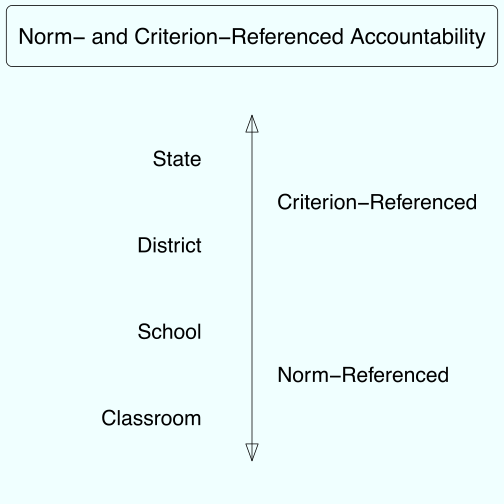
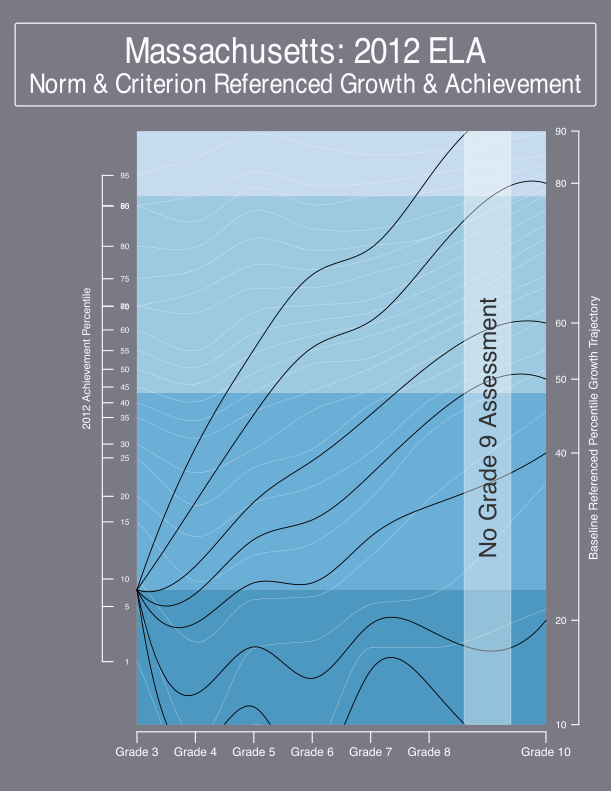
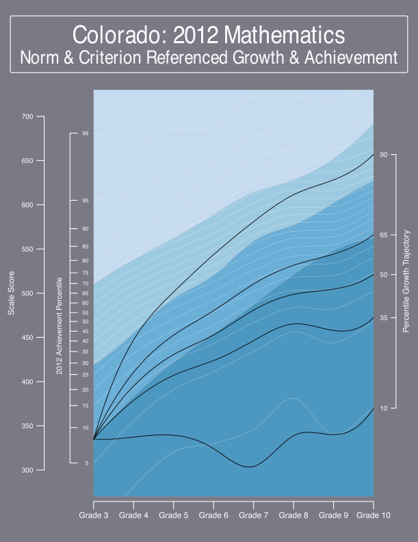
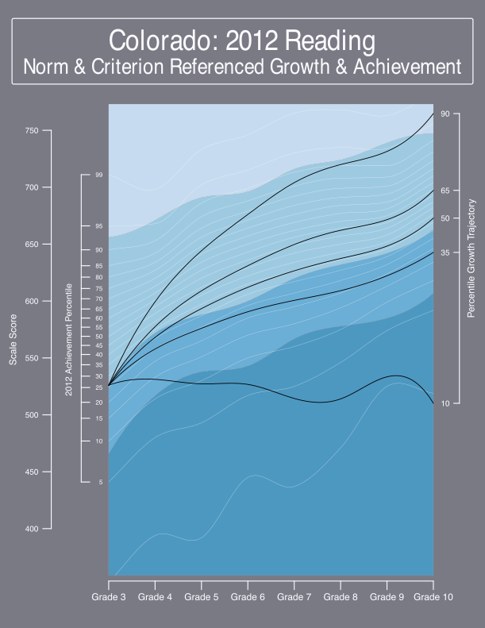
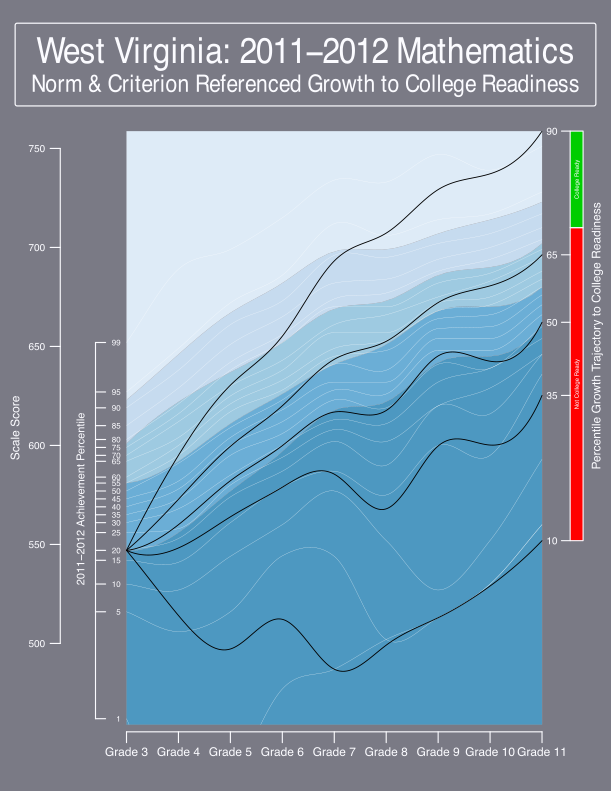
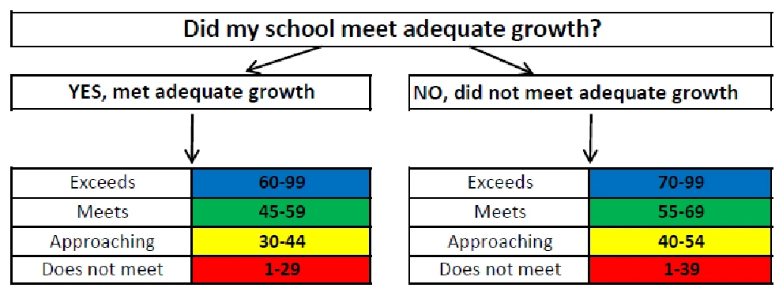
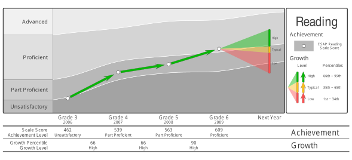

## Campbell's Law

::: {.larger}
> The more any quantitative social indicator is used for social decision-making, the more subject it will be to corruption pressures and the more apt it will be to distort and corrupt the social processes it is intended to monitor [@Campbell:1976].
:::

## Standardized Testing & Corruption

-   Not a new phenomenon in large scale educational assessment.

-   Corruption includes teacher/administrator cheating, student cheating, narrowing of curriculum, teaching to the test, lower student/teacher/stakeholder morale ....

-   Not limited to just teacher evaluation but also to institutional evaluation.

-   Tail (evaluation system) wagging the dog (education system).

-   Recent newsworthy incidents in Atlanta are likely just the tip of the iceberg.

## Standardized Testing & Corruption

-   Through RttT and ESEA waivers, teacher evaluation has been extended to "non-tested subjects".

-   As evaluation systems are mandated, the hunger for data/evidence to feed those systems becomes rabid.

-   Plans to utilize district, school and teacher constructed assessments in value-added analyses is not uncommon.

-   The potential for corruption is huge (e.g., artificially depress pre-scores).

-   Cheating with growth/value-added requires less "effort" than cheating with status: One only needs to get a couple more questions right.

## Living with Campbell's Law

-   I'm an optimist: I hold out hope that the human species can learn from evidence and make itself better.

-   I'm also a skeptic: I have a feeling that the next 10 years will prove my optimism to be foolish.

-   The likely reason for failure will be Campbell's Law.

-   Is it possible to overcome, circumvent, or just even minimize the effects of Campbell's Law.

-   That, I'd argue, is the main task confronting all of us.

## Living with Campbell's Law

-   Coherent

    -   Coherence with larger policy goals.

    -   Coherence within/across multiple levels of the system.

    -   Coherence with "reality".

-   Comprehensible

    -   Comprehensible to both the general public and professionals.

-   Comprehensive

    -   Use indicators to thoroughly vet other possible explanation.

    -   Use multiple indicators (i.e., pieces of evidence) to triangulate upon root causes.

## Norms & Criteria

-   Policy goals have morphed from universal *proficiency* to universal *career and college readiness*.

-   Policy goals have also changed to include comprehensive school and teacher evaluation as manifest in RttT, ESEA waivers, TIF, ...

-   State education accountability policy today extends from individual, to classroom, to school, to district, to state.

-   These policy goals, particularly when enacted with incoherent indicator systems, often lead to policy failure.

## Norms & Criteria

-   Fundamental challenge: Being fair to students while simultaneously being fair to adults (building fair evaluation systems).

-   Avoid setting different expectations for students (see recent incidents with ESEA waivers in Virginia and Florida) with fair evaluation systems.

-   Different unconditional (i.e., status) expectations versus different conditional (i.e., growth) expectations.

-   Differential Impact ≠ Bias: See, for example current large scale assessment systems.

-   Differential impact does not necessarily imply an unfair system. What passes the smell test?

## Norms & Criteria

-   From a tyranny of norms in the 80s and 90s to a tyranny of criteria in the early 21st century.

-   NCLB and ESEA waivers for institutional accountability are criterion referenced: directed toward universal proficiency.

-   Teacher evaluation using large scale assessments is almost exclusively norm-referenced.

-   Making the system coherent requires a blending norm- and criterion-referenced interpretations.

-   The proliferation of distinct and incoherent evaluation systems (institutional, personnel) threatens to detach evaluation from larger policy goals.

## Norm- and Criterion-Referenced Accountability {.figure-slide}

{fig-align="center" fig-alt="Diagram titled Norm- and Criterion-Referenced Accountability: a double-headed vertical arrow runs from State at the top through District and School to Classroom at the bottom. The upper, state and district end is labeled Criterion-Referenced; the lower, school and classroom end is labeled Norm-Referenced."}

## From norm to criterion referenced

-   At the state level, a state referenced norm provides no information.

-   How does one answer the question of whether a state education system, as a whole, is "adding value"?

-   This requires the system to be anchored to some baseline set of criteria (e.g., performance standards).

-   Growth to standard or baseline referenced growth/VAM analyses provide one possibility for addressing state level characterizations of value-added/growth.

## Massachusetts: 2012 ELA {.figure-slide}

{fig-align="center" fig-alt="Massachusetts 2012 ELA norm and criterion referenced growth and achievement chart for grades 3 to 10, with 2012 achievement percentiles over shaded achievement-level bands. Baseline referenced percentile growth trajectories fan out from a low grade 3 score, and a vertical band marks that there is no grade 9 assessment."}

## Colorado: 2012 Mathematics {.figure-slide}

{fig-align="center" fig-alt="Colorado 2012 Mathematics norm and criterion referenced growth and achievement chart for grades 3 to 10, with scale score and 2012 achievement percentile axes over shaded achievement-level bands. Percentile growth trajectories (10th, 35th, 50th, 65th and 90th) fan out from a low grade 3 score; only the higher trajectories reach the upper bands by grade 10."}

## Colorado: 2012 Reading {.figure-slide}

{fig-align="center" fig-alt="Colorado 2012 Reading norm and criterion referenced growth and achievement chart for grades 3 to 10, with percentile growth trajectories (10th, 35th, 50th, 65th and 90th) fanning out from a grade 3 score across shaded achievement-level bands; the 10th percentile trajectory stays flat while the others rise."}

## West Virginia: 2011–2012 Mathematics {.figure-slide}

{fig-align="center" fig-alt="West Virginia 2011–2012 Mathematics norm and criterion referenced growth to college readiness chart for grades 3 to 11. Percentile growth trajectories fan out from a grade 3 score, and a bar on the right splits grade 11 outcomes into College Ready (green, at the top) and Not College Ready (red)."}

## From norm to criterion referenced

-   As one moves from state to district to school to classroom, criterion referencing becomes less relevant.

-   Teacher evaluation using VAM/growth are almost exclusively norm-referenced.

-   Confusion between norm- and criterion-referenced indicators is often misunderstood.

-   Moving beyond the tyranny of norm- and criterion-referencing requires utilizing both.

## Blending Norms and Criteria {.figure-slide}

{fig-align="center" width="1500px" fig-alt="Flowchart: Did my school meet adequate growth? For YES, met adequate growth, the growth ratings are Exceeds 60–99, Meets 45–59, Approaching 30–44 and Does not meet 1–29. For NO, did not meet adequate growth, the cut points rise to Exceeds 70–99, Meets 55–69, Approaching 40–54 and Does not meet 1–39."}

## Blending Norms and Criteria

-   Colorado's School and District performance frameworks blend norm and criterion referencing.

-   What is typical, or even slightly above typical for schools serving lower achieving students is not enough to get students to desirable achievement levels.

-   The tries to balance norm- and criterion-referenced standards for school and district evaluation setting more ambitious, but reasonable goals for schools serving low achieving students.

## Norm-referenced Classroom analyses

-   Analyses at the classroom/teacher level are almost exclusively norm-referenced.

-   Debate about whether norms should include additional variables besides prior student achievement are frequent.

-   Additional variables can include both individual (e.g., demographic) and group level characteristics (e.g., mean prior group achievement).

-   Differential impact often mandates adjustment but states are approaching these topics very carefully.

## Internal Coherence

-   Face validity: Do the results pass the "smell test".

    -   What is the relationship between poverty & classroom/school effectiveness indicated by the model?

    -   What is the relationship between prior achievement & classroom/school effectiveness indicated by the model?

-   Recent papers (e.g., Ehlert et al.) are directed toward discussion of the most *useful* comparison.

-   As data becomes more and more available, edge cases will become front page headlines.

-   Recent stories from New York are likely (meet the worst teacher in New York City)

    -   States with test ceilings often demonstrate model misfit at the extremes, especially for a large class of linear models.

    -   Phenomenon is especially pronounced with a significant proportion of students score at the ceiling.

## Public Comprehension

-   User Experience: Stakeholder engagement is critical and requires a broad communication strategy.

-   Being able to comprehend is not the same as being able to calculate.

-   Lack of comprehension amongst stakeholders is a result of lack of relevant/understandable vocabulary and use cases for that vocabulary.

-   Communication of assessment results don't digress into IRT methodology. Why must explanations of growth/value-added often digress into explanations of regression?

-   It is critical to be able to communicate results without resorting to the "R" word.

## Individual Growth and Achievement Report: Reading {.figure-slide}

{fig-align="center" fig-alt="Individual student growth chart for Reading, grade 3 (2006) to grade 6 (2009), over bands for Unsatisfactory, Part Proficient, Proficient and Advanced. Scale scores 462, 539, 563 and 609 climb from Unsatisfactory through Part Proficient to Proficient, with growth percentiles of 66, 66 and 90 (all High); a fan of low, typical and high growth projections extends to next year."}

## Communication of results

-   A grossly ignored area of research

-   We are currently in the initial stages of a renaissance in data visualization

-   It is no longer necessary to fit results (and the stories they support) onto an 8 1/2 by 11 sheet of paper.

-   Interactive technology via intuitive navigation support complex data narratives that can't fit onto a single sheet of paper.

-   Enhanced user experience with education data is largely untapped.

## Professional Comprehension

-   Analytic techniques utilized for teacher/institutional evaluation are often closed and proprietary.

-   Publication of statistical methodology falls far short of showing how that methodology is enacted in software.

-   Will contested evaluations based upon closed methodologies withstand legal scrutiny?

-   The field would benefit greatly from greater transparency including open sourcing of analytic techniques and non-confidential data derived from these techniques.

-   Open Source ≠ Public Domain: There are a variety of open source licenses that allow creators to maintain control over the various ways in which their work is used.

{.nostretch fig-align="center" width="900px" fig-alt="Creative Commons license badges for CC BY-SA and CC BY-NC-SA."}

## Comprehensive exploration of root causes

-   The heightened focus on teacher evaluation has left teacher feeling "picked on".

-   Improvement in teacher evaluation systems should not come at the exclusion of comprehensive investigations of root causes that extend beyond the teacher.

-   There are numerous complicating factors that cloud the attribution of responsibility to the teacher.

    -   Institutional transitions impact the growth rates of students.

    -   These transitions do *not* occur uniformly with state or even within district (e.g., middle schools and junior high schools).

    -   The impact can be so large that it makes "signal detection" at the teacher level impossible.

## Comprehensive Evaluation Systems

-   The use of large scale assessments for educator/institutional evaluation is low hanging fruit.

-   Collecting and combining multiple sources of evidence is the status quo in all state evaluation systems.

-   Moving beyond Campbell's Law requires embracing *more* data and reconciling often conflicting pieces of evidence.

## References {.smaller .scrollable}

::: {#refs}
:::
