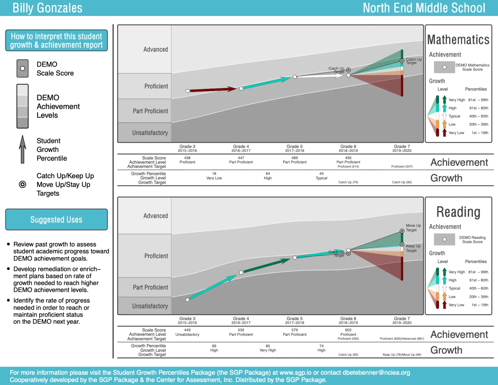
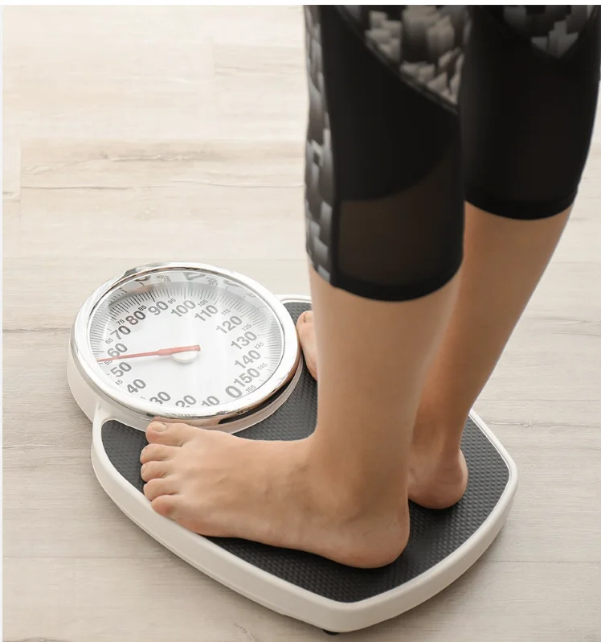
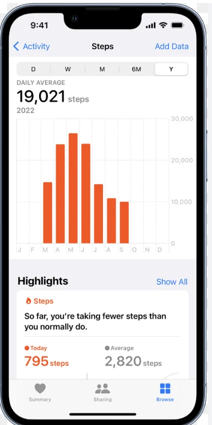

## My Background in Assessment Reporting

- Began work at the Center for Assessment in 2007 wanting to “take over” the growth model world developing Student Growth Percentiles (SGP)
- Wanted to make analytics cheap/open and focus on reporting to make the data useful.
- Co-developed the SchoolView interactive data visualization platform with the Colorado Department of Education and deployed it to 5 states (no longer in use).
- Developed PDF based individual student reports as part of the SGP package. Currently used by several states to produce approximately 1 million student reports/year.
- My strong belief from the beginning is that bigger improvements in education are possible through reporting and use of data versus the derivation of “better” data.

## Individual Student Growth and Achievement Report

{fig-align="center" fig-alt="A demonstration SGP package student growth and achievement report for a fictitious student on the DEMO assessment, grades 3 to 7. Mathematics and reading panels show each year's scale score and achievement level, the student growth percentile between years, and fan-shaped growth projections toward catch-up, keep-up and move-up targets, with a sidebar explaining how to read the report and suggested uses."}

## Lessons Learned

- I’ve learned several lessons along the way.
- I hope to share and dive into a few of these lessons today
    - Data is/are worthless, it’s what one does with it/them that is valuable.
    - Data ≠ Information: Ideally our reporting efforts transform data into information.
    - Data visualization, especially when designed by data specialists like ourselves, is oftentimes self indulgent: More suited for ourselves than the users we want to inform.
    - Terminology/vocabulary in our field is a mess.
    - Reporting needs to move from “actionable” to “actions”.

## Data are worthless

- We live in a world where data have become extremely cheap.
- Education data producers (Interims, state assessments, NAEP, SEDA) are competing for prominence.
- Secondary data analysis on  assessment data just adds more data to an already overflowing pool.
- A more important endeavor (IMHO) is how to help stakeholders make better sense from the massive amounts of data we already have to improve student learning.

## Data ≠ Information

- Maybe it’s just semantics, but semantics are important.
- Our profession is dedicated to the craft of producing education assessment data of the highest quality.
- This data is, in general, barely informative to non-technical stakeholders.
- Giving people data and calling it information without really understand how the data actually informs is a lie, a sales pitch, a con job.
- The SchoolView visualization platform I developed seemed informative (to me). But in retrospect it wasn’t nearly as informative to the non-technical stakeholders that I was trying to inform.
- Even the highly graphical (info-graphic) student reports that I produced to be “self-explanatory” require a large amount of background knowledge to understand.

## Gratuitous Data Viz

- The majority of data-visualizations most of us have seen as part of our training are designed for data specialists.
- Creating data visualizations that inform non-specialists is EXTREMELY difficult and subtle.
- Scatterplots based upon two or more variables (SchoolView) is NOT the way.
- Terms like percentiles, even though somewhat familiar to many non-technical stakeholders, are intimidating and not informative.

## We have a problem with vocabulary

- A primary goal of assessment reports is, presumably, to assist in student **learning**.
- However, an assessment does NOT measure learning!
- An assessment measures, ideally, what a student knows and can do at a point in time (i.e., what has been learned; attainment)
- Learning is an latent process that occurs over time.
- We infer learning via the use of multiple observations/assessments over time.
- We need to get much better at communicating how assessments (plural) can and should be used by teacher to assist with their teaching in service of student learning.

## From Actionable to Actions (Wiley, 2020)

- The primary goal of assessment reports is, presumably, for them to be “actionable.”
- That is, a teacher, student, or administrator should be able to take an action after spending time interpreting the report.
- For that to be possible, three questions must be answered in the affirmative.
    - Does the report communicate something useful? (design relevance)
    - Can the user figure out what the useful bit(s) of information is(are) after studying the report? (data/visualization literacy)
    - Can the user figure out what to do based on the useful bit(s) of information? (instructional design literacy)

## From Actionable to Actions (Wiley, 2020)

- Why not circumvent all of the “load” placed on the end user to make sense of and then take action with the data?
- That is, reports and dashboards should be much more action focused than data focused.
- That requires that we ourselves more deeply understand these actions.
- NOTE: Actions might include collecting more data/evidence in order to know what to do.

## The 5 Ws

- What, who, why, when and where:
    - **What?** Describe the specific action those using the report should consider taking.
    - **Why?** Explain why they should consider taking it.
    - **When?** How soon should they decide whether or not to take action?
    - **Who?** Who (e.g., which students) should those using the report consider taking action with?
    - **Where?** In what format, with what tools, or in what place should those using the report take the action?

## Summary

- We need to fundamentally rethink reporting of assessment results.
- And to be honest, we are probably not the right people to do the rethinking.
- Looking outside the field of education for exemplars is probably a good start.
- An intriguing example I like are the fitness/health apps on the phones that we carry

## Outcome vs. Process/Action

:::: {.columns .v-center-cols}
::: {.column width="40%"}
::: {style="text-align: center;"}
Outcome

{.nostretch height="700px" fig-alt="Bare feet standing on a bathroom scale: a single outcome measurement."}
:::
:::
::: {.column width="18%"}
::: {style="text-align: center; font-size: 3.5em; padding-top: 1.6em;"}
VS
:::
:::
::: {.column width="40%"}
::: {style="text-align: center;"}
Process/Action

{.nostretch height="700px" fig-alt="A phone fitness app showing daily step counts by month, a daily average of 19,021 steps, and a highlight noting that today the user is taking fewer steps than usual: data framed around ongoing actions."}
:::
:::
::::

## {.center}

::: {style="text-align: center; font-size: 3em;"}
Thank You
:::

