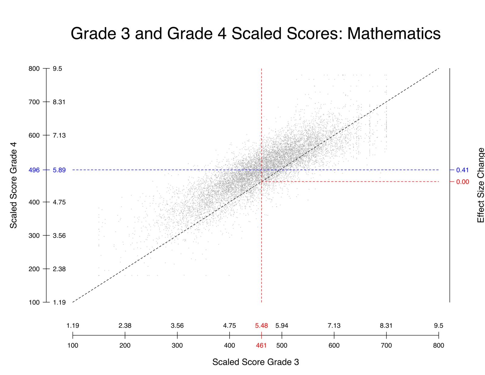
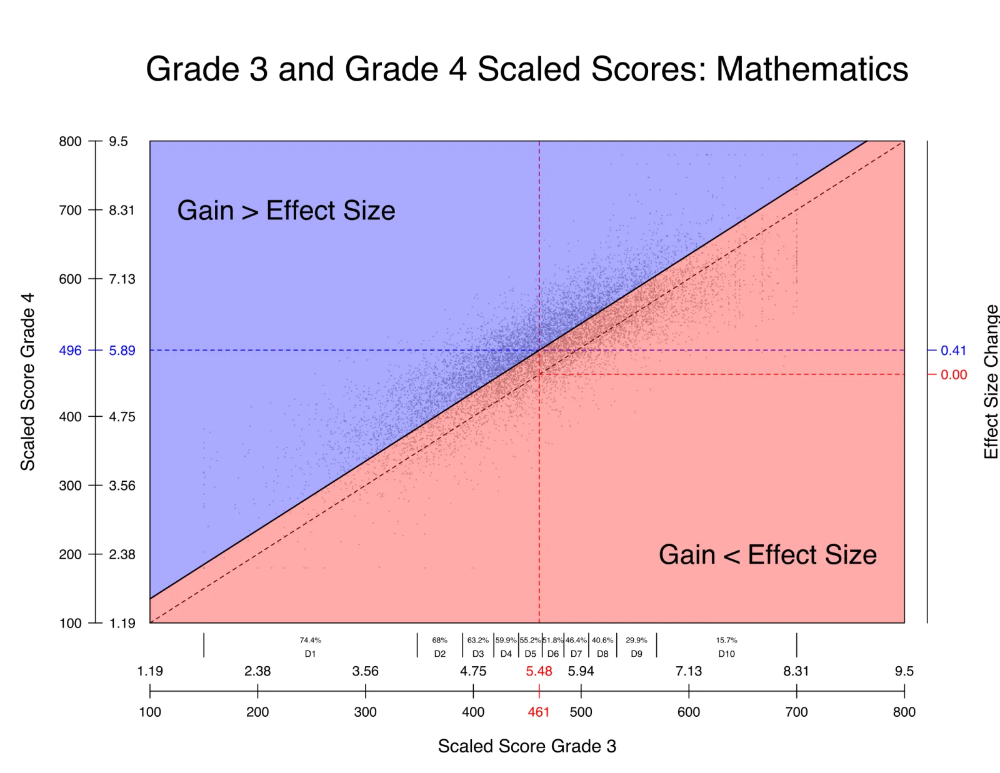
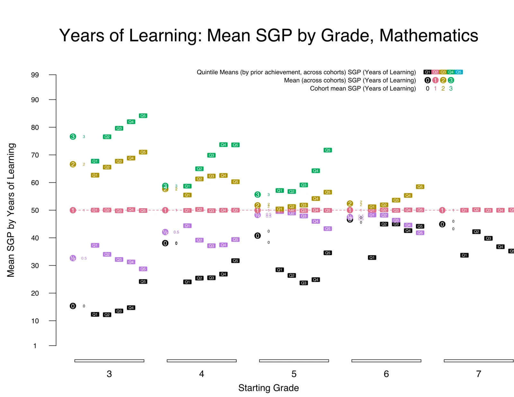
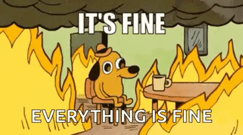
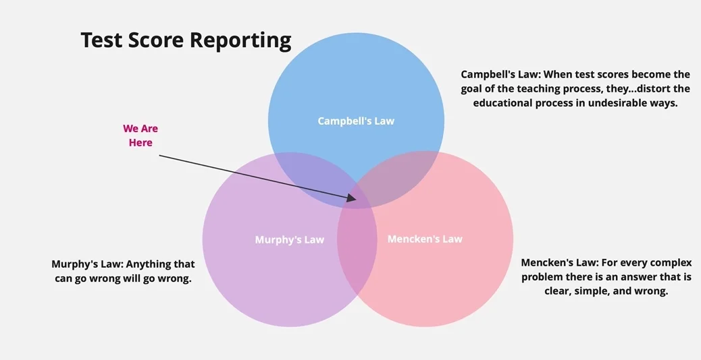
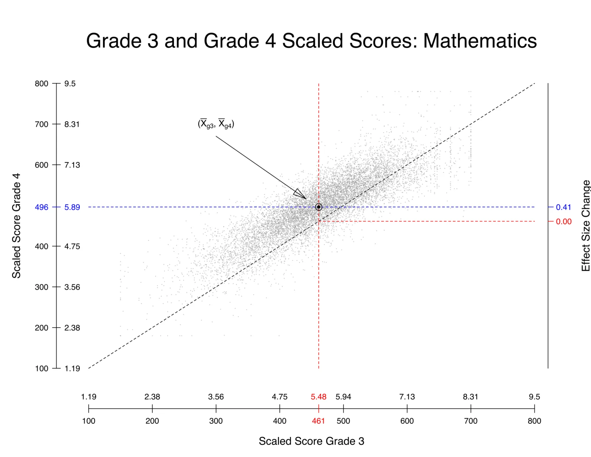
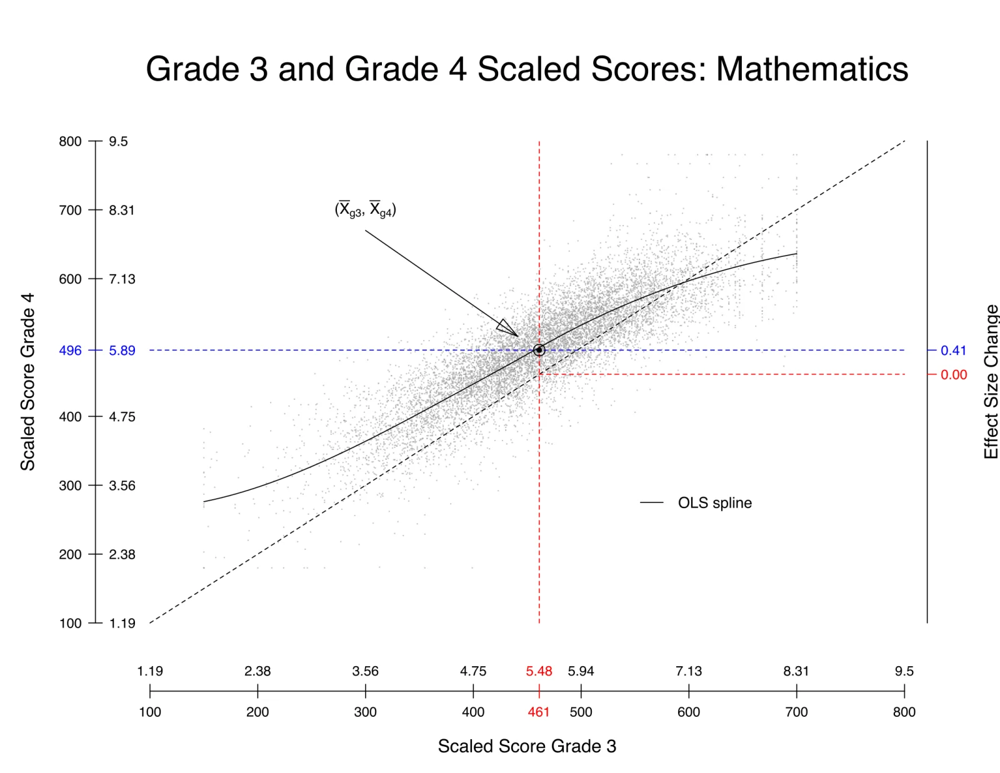
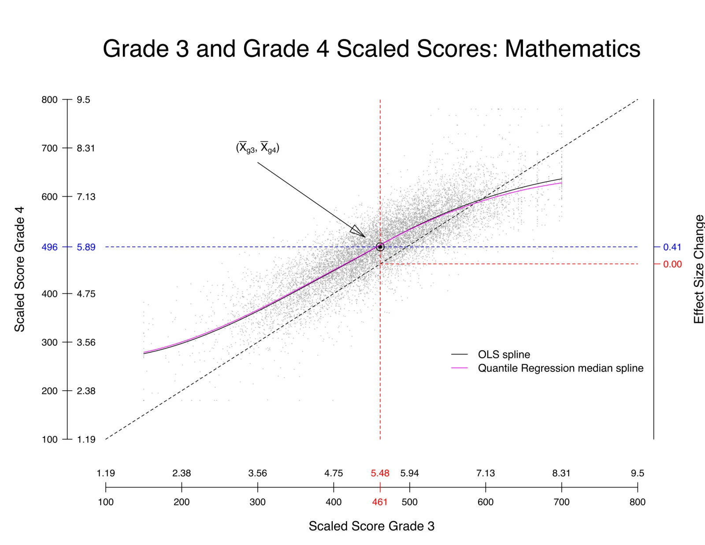
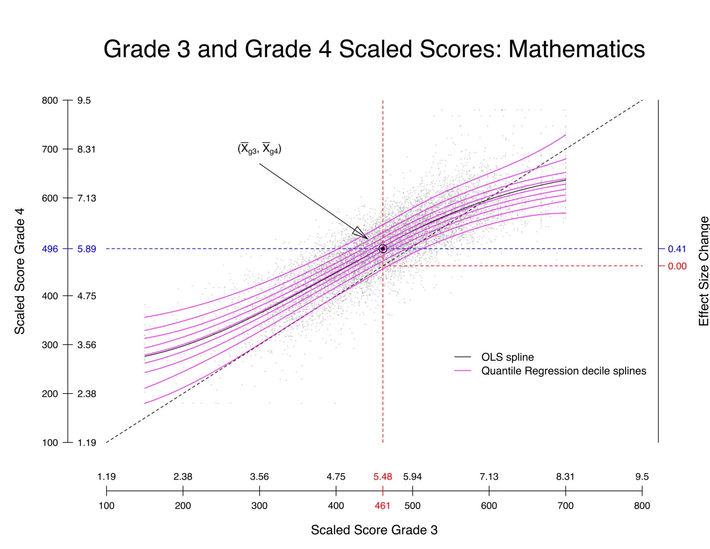

## Time, Measurement, and Learning

:::: {.columns}
::: {.column width="48%"}
::: {.key-insight-box}
Performance of fourth-grade students on the 2022 NAEP Reading test dropped 7 points from 2018 to the lowest point it has been since 1990.
:::

***Can we use the illusion to interpret the arbitrary so that we better understand the illusive?***

[Four Perspectives]{.underline}

- Semantics
- Technical Foundations
- Empirical Validation
- Utility
:::
::: {.column width="48%"}
**“*Time is an illusion*” – Einstein**

***Educational measurement is arbitrary.***

***Learning is illusive.***

::: {.theorem-box}
The 8^th^ grade average score of 500 in 2023 is equal to the average score of 6th students in 2019.
:::

::: {.warning-box}
Students are two years behind, a half-year behind, six weeks behind…
:::
:::
::::

## Semantics: Learning and Time

- Learning ≠ Achievement
- Learning is a rate: Learning = (Change in Achievement)/Time
- Learning is not linear or uniform over time
- Learning is inherently an individual activity
- Time-based estimates are inherently focused on the group
- Time is rarely the most important variable affecting learning
- Time is out of favor as a relevant factor when discussing learning or achievement

## Semantics: Time-based estimates

- We’ve travelled this road before
- At their core, there is little difference between today’s time-based estimates and the grade equivalent scores soundly rejected by the measurement field and educators in the NRT era
- Prima facie, converting a quasi-interval scale to a ratio scale is akin to psychometric alchemy

## Technical Foundations

***Measurement is never better than the empirical operations by which it is carried out, and operations range from bad to good. – S.S. Stevens (1946)***

::: {role="list" aria-label="Operations from test to time-based estimate" style="display: flex; gap: 0.4em; margin: 1em 0 0.6em; font-size: 0.8em;"}
::: {role="listitem" style="flex: 1; display: flex; align-items: center; justify-content: center; text-align: center; min-height: 3.6em; padding: 0.2em; background: var(--color-primary-ink); color: var(--color-surface); line-height: 1.2;"}
Test
:::

::: {role="listitem" style="flex: 1; display: flex; align-items: center; justify-content: center; text-align: center; min-height: 3.6em; padding: 0.2em; background: var(--color-primary-ink); color: var(--color-surface); line-height: 1.2;"}
Student **Response**
:::

::: {role="listitem" style="flex: 1; display: flex; align-items: center; justify-content: center; text-align: center; min-height: 3.6em; padding: 0.2em; background: var(--color-primary-ink); color: var(--color-surface); line-height: 1.2;"}
Theta Score
:::

::: {role="listitem" style="flex: 1; display: flex; align-items: center; justify-content: center; text-align: center; min-height: 3.6em; padding: 0.2em; background: var(--color-primary-ink); color: var(--color-surface); line-height: 1.2;"}
Scaled Score
:::

::: {role="listitem" style="flex: 1; display: flex; align-items: center; justify-content: center; text-align: center; min-height: 3.6em; padding: 0.2em; background: var(--color-primary-ink); color: var(--color-surface); line-height: 1.2;"}
Vertical Scale Score
:::

::: {role="listitem" style="flex: 1; display: flex; align-items: center; justify-content: center; text-align: center; min-height: 3.6em; padding: 0.2em; background: var(--color-primary-ink); color: var(--color-surface); line-height: 1.2;"}
Standard Deviation
:::

::: {role="listitem" style="flex: 1; display: flex; align-items: center; justify-content: center; text-align: center; min-height: 3.6em; padding: 0.2em; background: var(--color-primary-ink); color: var(--color-surface); line-height: 1.2;"}
Effect Size
:::

::: {role="listitem" style="flex: 1; display: flex; align-items: center; justify-content: center; text-align: center; min-height: 3.6em; padding: 0.2em; background: var(--color-primary-ink); color: var(--color-surface); line-height: 1.2;"}
Time-Based Estimate
:::
:::

::: {style="margin: 0 3em; border-top: 2px solid var(--color-secondary); padding-top: 0.6em;"}
Even accepting that each individual operation along the way is *good*, the conceptual and empirical distance travelled is simply too great to support technically sound, interpretable, useful time-based reporting of student test scores.
:::

## Empirical Validation

- Do the vertical scales we have in education support time based interpretations of learning?
- The original question motivating this line of inquiry was:

::: {.accent-pink style="text-align: center; font-size: 1.3em; margin: 0.6em 0;"}
How common is it to see students making two years worth of learning in a single year?
:::

- We used growth norms derived through the SGP framework to answer this question.
- To see how we need a little background.

## Background

- Following Yen (1986) and Dadey and Briggs (2012), cross-grade, effect size is defined as the standardized mean difference between grade x content area means ($g_1$) and ($g_2$) using the pooled standard deviation:

  $$\text{Effect Size} \equiv \frac{\overline{X}_{g1} - \overline{X}_{g2}}{\sqrt{\dfrac{\hat{\sigma}^2_{g1} + \hat{\sigma}^2_{g2}}{2}}}$$

- There are several aspects of this definition worth noting

## Background

$$\text{Effect Size} \equiv \frac{\overline{X}_{g1} - \overline{X}_{g2}}{\sqrt{\dfrac{\hat{\sigma}^2_{g1} + \hat{\sigma}^2_{g2}}{2}}}$$

- The effect size associated with a year’s worth of learning is standardized, average distance. That is, it’s largely a normative definition.
- To calculate this effect size requires that the numerator be on the same scale so that subtraction makes sense. That is, we require a vertical scale.
- The effect size quantifies the extent to which the mean has shifted between the two scaled score distributions.
- There will be considerable overlap in the students in $g_1$ and $g_2$ in most applications of the above Equation to state summative assessment data.
- However, there is no requirement that $g_1$ and $g_2$ consist of the same students (e.g., NAEP).

## Illustration

{fig-align="center" fig-alt="A scatterplot of grade 3 (horizontal axis) against grade 4 (vertical axis) mathematics scaled scores, with dashed lines at the grade means and secondary axes expressing scores as effect-size change."}

## Illustration

{fig-align="center" fig-alt="A scatterplot of grade 3 (horizontal axis) against grade 4 (vertical axis) mathematics scaled scores, split by a diagonal line into a blue region labeled Gain > Effect Size above it and a red region labeled Gain < Effect Size below it."}

## Illustration

:::: {.columns .v-center-cols}
::: {.column width="40%"}
- Note that the effect-size definition of a year’s worth of learning doesn’t translate well to the individual level
- Due to the well known negative correlation between prior score and gain, there are large disparities of students making a year’s worth of learning
    - 1st Decile: 74.4%
    - 10th Decile: 15.7%
- Using regression we can extend the initial definition to accommodate this.
:::
::: {.column width="58%"}
{fig-alt="A scatterplot of grade 3 (horizontal axis) against grade 4 (vertical axis) mathematics scaled scores, split by a diagonal line into a blue region labeled Gain > Effect Size above it and a red region labeled Gain < Effect Size below it."}
:::
::::

## Illustration

:::: {.columns .v-center-cols}
::: {.column width="40%"}
- The extension of the concept of a year’s worth of learning using the SGP framework sets 50th percentile growth to be a year’s worth of learning.
- Note that an SGP is a percentile and indicates a (conditional) probability.
- In the year in which the SGP norms are established, 50% of student will be above/below the year of learning threshold
:::
::: {.column width="58%"}
{fig-alt="A scatterplot of grade 3 (horizontal axis) against grade 4 (vertical axis) mathematics scaled scores, with the point of the grade means marked and an OLS spline plus quantile regression decile splines fanning across the data."}
:::
::::

## Data & Analyses

- We utilize vertically scaled data from 4 different states.
- Using this data we create growth norms (coefficient matrices in two ways)
    - Consecutive grade growth norms (e.g., grade 3 to 4 growth norms).
    - Growth norms extending across two years (e.g., grade 3 to 5 growth norms)
- Using these growth norms we:

## Analyses

- We calculate SGPs in various ways to determine the probability associated with growth across different time spans using actual, student longitudinal data:
    - 0 Years of Growth: Assume identical scores for students from one grade to the next and feed those data into  the 1 year growth norms
    - 2 Years of Growth: Use scores for individual students spanning two years (e.g., grade 3 and grade 5) and feed those data into the 1 year growth norms.
    - 3 Years of Growth: Use scores for individual students spanning three years (e.g., grade 3 and grade 6) and feed those data into the 1 year growth norms.
    - 1/2 Years of Growth: Use scores for individual students spanning one year (e.g., grade 3 and grade 4) and feed those data into the 2 year growth norms.
- For example, we wish to know what is the average of the one year SGPs when we feed into growth representing two years of learning for students.
    - Is two years worth of learning an SGP of 90, 80, 70, …?

## Results

{fig-align="center" fig-alt="Years of Learning: Mean SGP by Grade, Mathematics. For starting grades 3 to 7, mean SGPs are plotted for 0, one-half, 1, 2 and 3 years of learning, overall and by prior-achievement quintile. One year sits at 50 by construction; in grade 3, two and three years sit far above 50 and zero years far below, and the spread narrows in higher grades."}

## What does this all mean?

- The results, in general, are not believable.
    - For example, from grades 3 to 4, two years worth of learning was observed about 35% of the time.
    - Put another way, of those students making at least a year’s worth of learning, about two-thirds of them make two or more year’s worth of growth!
- The results are more absurd in higher grades!
- Our conclusion is that the scales we have cannot support a mapping of elapsed time onto them. They just can’t
- That doesn’t mean all is lost.

## Is there any hope?

- Perhaps a more modest utilization of time is possible without jumping to talking about weeks, months, years of learning.
- For example, taking 50th percentile growth as “a year’s worth of learning”, it is likely defensible to produce either a dichotomy or trichotomy:
    - Dichotomy:
        - Below a year’s worth of learning.
        - At/Above a year’s worth of learning
    - Trichotomy:
        - Substantially below a year’s worth of learning,
        - At or Near a Year’s worth of Learning,
        - Substantially above a year’s worth of learning.

## Utility

- *I used to say, “it is better to be complicated than wrong.” But recently I've relaxed this perspective when engaging with the public about measurement. I'd rather people be interested and learn more than tune out entirely. This comes with risks. I'll accept them. – Andrew Ho (Sept 1, 2022)*

:::: {layout-ncol=3}
{fig-alt="“What, Me Worry?” meme: Alfred E. Neuman grinning."}

```{=html}
<picture>
  <source srcset="figures/fig-06-still.webp" media="(prefers-reduced-motion: reduce)">
  
</picture>
```

{fig-alt="“What could possibly go wrong?” meme with a grinning cartoon character."}
::::

## Test Score Reporting

{fig-align="center" fig-alt="A Venn diagram titled Test Score Reporting with three overlapping circles: Campbell's Law (when test scores become the goal of the teaching process, they distort the educational process in undesirable ways), Murphy's Law (anything that can go wrong will go wrong) and Mencken's Law (for every complex problem there is an answer that is clear, simple, and wrong). An arrow labeled We Are Here points to the center where all three overlap."}

## Utility –  Problems with Time-based Reporting

1. Time-based reporting is devoid of content.
2. Time-based reporting leads stakeholders toward time-based solutions.
3. The aggregate-level results which are at the core of time-based reporting are not representative of what is taking place at the individual level.

## Questions?

{fig-align="center" fig-alt="A large question mark built from many small multicolored question marks."}

## {.center}

::: {style="text-align: center; font-size: 3em;"}
Extra Slides
:::


## Illustration

{fig-align="center" fig-alt="A scatterplot of grade 3 (horizontal axis) against grade 4 (vertical axis) mathematics scaled scores, with the point of the two grade means marked."}

## Illustration

{fig-align="center" fig-alt="A scatterplot of grade 3 (horizontal axis) against grade 4 (vertical axis) mathematics scaled scores, with the point of the grade means marked and an OLS spline drawn through the data."}

## Illustration

{fig-align="center" fig-alt="A scatterplot of grade 3 (horizontal axis) against grade 4 (vertical axis) mathematics scaled scores, with the point of the grade means marked and an OLS spline and a quantile regression median spline drawn through the data."}

## Illustration

{fig-align="center" fig-alt="A scatterplot of grade 3 (horizontal axis) against grade 4 (vertical axis) mathematics scaled scores, with the point of the grade means marked and an OLS spline plus quantile regression decile splines fanning across the data."}

