## About Me

::: {.key-insight-box}
::: {.key-insight-box-title}
Dr. Damian Betebenner, PhD
:::

::: {.box-body style="padding-left: 1.7em;"}
-   Senior Associate at the Center for Assessment (NCIEA).

-   Developed student growth percentiles and percentile growth trajectories to help states and educational associations employ student growth in decision making [@Betebenner:2008; @Betebenner:2009; @Betebenner:2012].

-   Currently refining and sharing these techniques with more than 25 states in the United States, testing companies (Renaissance Learning), and other countries including Australia.
:::
:::

## About Me

::: {.key-insight-box}
::: {.key-insight-box-title}
Dr. Damian Betebenner, PhD
:::

::: {.box-body style="padding-left: 1.7em;"}
-   Educational Background: PhD in Education Measurement from the University of Colorado, Boulder and a PhD in Mathematics from the University of Wyoming.

-   Began using R in 1999 to produce high quality graphics and it has been seminal in expanding my work.

-   I'm more of a \"data scientist\" than a statistician. SGPs are more of a \"data science\" approach to examining student academic growth than a \"statistician\" approach.
:::
:::

## History {.smaller}

:::: {.columns}
::: {.column width="50%"}
2004-2007

:   Assistant Professor Boston College, ERME.

2005-2007

:   Began development of the Colorado Growth Model (Student Growth Percentiles).

2008

:   Successful application of Colorado Growth Model (criterion-referenced component) as part of growth model pilot program.

2009-2010

:   Began/continued work with approximately two-dozen other states on developing state growth models.

2010

:   Worked with states on incorporating growth into RttT applications and with successful states on their use (Massachusetts, Georgia, New York, Rhode Island).

2011

:   Worked with a number of states on incorporating student growth percentiles into the ESEA waiver applications and teacher evaluation systems.
:::

::: {.column width="50%"}
2012

:   Worked with 5 states (including Rhode Island) on co-developing SchoolView interactive visualizations to help better communicate student growth percentile results.

2014

:   Built SIMEX measurement error correction into SGP model [@ShanVanI:2015]

2014

:   Extended analyses to accommodate time-dependency allowing for SGP modelling of interim assessments.

2017

:   Extended SGP package to better accommodate assessment transitions.

2015-present

:   Work with about 20 states in different capacities to calculate SGPs.

2020-2023

:   Utilized SGPs to examine academic impact and recovery due to the COVID-19 pandemic.
:::
::::

## About the growth model

-   The Student Growth Percentiles Methodology is a norm- and criterion-referenced growth analysis method [@Betebenner:2009].

-   The norm-referenced component of the model is the student growth percentile which indicates the relative growth a student makes.

-   The criterion-referenced component of the model is the student growth percentile target which indicates the amount of growth required by the student to reach/maintain desirable achievement goals in a specified time frame. For example, catching-up to proficiency within 3 years.

-   The norm- and criterion-referenced components together allow stakeholders to understand *what is*, *what should be*, and *what is reasonable* simultaneously.

-   The goal of the metric was to assist states to move beyond debates over what thermometer is best to discussions of how best to use the thermometer.

## Built to maximize sharing

A number of analytic tools (for doing calculations) and visualization tools have been developed with the goal to promote maximum sharing.

-   Data isn't valuable! It's what one does with data that is potentially valuable!

-   The analytic tools to calculate all the quantities associated with student growth percentiles are open source and freely available to all states [@SGP:2025]. [sgp.io](https://sgp.io)

-   Conduct training sessions at national conferences to help others calculate these quantities on their own.

-   Build enhanced visualization and reporting systems to make data come alive to stakeholders, allow for stakeholder collaboration and sharing, and lead to better stakeholder engagement with data.

## Guiding Questions

::: {.key-insight-box}
::: {.key-insight-box-title}
Growth models address specific questions
:::

::: {.box-body style="padding-left: 1.7em;"}
-   Different growth analysis techniques are good at answering different questions.

-   It is critical to understand these different questions.

-   Different questions lead to different conversations which lead to different uses and outcomes.
:::
:::

::: {.key-insight-box}
::: {.key-insight-box-title}
Changing conversations about education
:::

::: {.box-body style="padding-left: 1.7em;"}
-   Starting with the right questions simplifies development and motivating the proper use of the growth model results.

-   The questions set the table for those conversations.

-   Yen (2007) for an excellent list of questions derived from a survey of parent, teachers and administrators
:::
:::

## What are the relevant questions for parents?

Yen (2007), from a state survey of parents, teachers and administrators, compiled a list of frequently voiced questions/concerns by stakeholder group.

::: {.key-insight-box}
::: {.key-insight-box-title}
Parent Questions
:::

::: {.box-body style="padding-left: 1.7em;"}
-   Did my child make a year's worth of progress in a year?

-   Is my child growing appropriately toward meeting state standards?

-   Is my child growing as much in Math as Reading?

-   Did my child grow as much this year as last year?
:::
:::

## What are the relevant questions for teachers?

Yen (2007), from a state survey of parents, teachers and administrators, compiled a list of frequently voiced questions/concerns by stakeholder group.

::: {.key-insight-box}
::: {.key-insight-box-title}
Teacher Questions
:::

::: {.box-body style="padding-left: 1.7em;"}
-   Did my students make a year's worth of progress in a year?

-   Did my students grow appropriately toward meeting state standards?

-   How close are my students to becoming Proficient?

-   Are there students with unusually low growth who need special attention?
:::
:::

## What are the relevant questions for administrators?

Yen (2007), from a state survey of parents, teachers and administrators, compiled a list of frequently voiced questions/concerns by stakeholder group.

::: {.key-insight-box}
::: {.key-insight-box-title}
Administrator Questions
:::

::: {.box-body style="padding-left: 1.7em;"}
-   Did the students in our district/school make a year's worth of progress in all content areas?

-   Are our students growing appropriately toward meeting state standards?

-   Does this school/program show as much growth as that one?

-   Can I measure student growth even for students who do not change proficiency categories?

-   Can I pool together results from different grades to draw summary conclusions?
:::
:::

## What are the relevant questions for policy makers?

::: {.key-insight-box}
::: {.key-insight-box-title}
Policy Maker Questions
:::

::: {.box-body style="padding-left: 1.7em;"}
-   Can/how should student growth be used in judgments of educator quality?

-   Can/how should student growth be used in judgments of education (e.g., school) quality?

-   Are students on track for career and college readiness?

-   What adjustments for student demographics need to be considered?
:::
:::

## Growth & Accountability

::: {.key-insight-box}
::: {.key-insight-box-title}
Growth versus Status
:::

::: {.box-body style="padding-left: 1.7em;"}
-   Enthusiasm for growth in accountability stems from the belief that learning (i.e., growth) and teacher/school quality are more closely related than status (i.e., attainment).

-   Enthusiasm for growth also stems from its potential diagnostic uses.
:::
:::

## Growth & Accountability

::: {.key-insight-box}
::: {.key-insight-box-title}
Fundamental Premise
:::

"Good" schools/teachers sustain learning (i.e., bring about growth in student achievement) in excess of that found at "bad" schools/teachers.
:::

-   The inherent believability of this premise is at the heart of current enthusiasm to incorporate growth models into accountability systems.

-   Note that current accountability systems (from NCLB through ESSA) invoke the same premise (with achievement substituted for growth).

-   "Good schools/teachers" are commonly referred to as highly effective schools/teachers.

-   It is critical to understand the distinction between *growth* and *effectiveness*.

## Value-Added & Growth

**[Who or what is responsible for student]{.accent}**

-   Often, analyses of student growth attempt to determine the amount of student progress/growth that can be attributed to the school or teacher.

-   Called Value-added analyses, these techniques attempt to estimate the teacher/school contribution to student achievement.

-   Value-added models quantify effectiveness---purporting to measure the impact on achievement that this school or teacher would have, on average, upon similar students assigned to them.

-   These models and their effectiveness claims are controversial for a number of reasons (EPI (2010), NRC/NAE (2010), Braun (2005), Rubin and Stuart (2004)).[@EPI:2010; @NRC/NAE:2010; @Braun:2005; @RubiStua:2004]

## Value-Added & Growth

**[Who or what is responsible for student]{.accent}**

-   Value-added models are better described as **[effectiveness]{.accent}** models than as growth models.

-   Value-added is an inference -- a causal conclusion drawn from the data.

-   Value-added isn't a type of statistical model or type of assessment.

-   All growth models can be used for value-added purposes but not vice-versa.

## Descriptive Accountability

Accountability system results can have value without making causal inferences about school quality, solely from the results of student achievement measures and demographic characteristics. Treating the results as descriptive information and for identification of schools that require more intensive investigation of organizational and instructional process characteristics are potentially of considerable value. Rather than using the results of the accountability system as the sole determiner of sanctions for schools, they could be used to flag schools that need more intensive investigation to reach sound conclusions about needed improvements or judgments about quality [@Linn:2008, p. 21].

## Describing Student Growth

-   The concept of student growth isn't as difficult to understand and popular perception suggests.

-   Calculations may be complicated but knowing how to calculate student growth is not synonymous with understanding student growth:

    -   Thenumber $\pi$ (pi=3.14159...)is difficult to calculate but is simple to understand conceptually.

    -   Height and weight percentiles associated with children are difficult to calculate but are simple to understand conceptually.

-   Computational details are important but often obscure a simple conceptual basis.

## Describing Student Growth

-   Measuring student growth, even with a vertical scale, is not a simple task.

-   Some believe a vertical scale simplifies the task of measuring student growth.

-   Even with an interval (or ratio) scale, growth is not easy to interpret. Consider, for example, height.

    -   A child might grow 4 inches between ages 3 and 4.

    -   4 inches is a well understood quantity.

    -   The 4 inch increase becomes really meaningful only when understood alongside the growth of other 3 to 4 year olds.

-   **[Student growth percentiles]{.accent}** were developed to provide a normative context for describing student growth.

## The Illusion of Vertical Scales

:::: {.columns}
::: {.column width="50%"}
-   Whose high jump changed more? Explain your answer.

-   Whose high jump change is more remarkable? Explain your answer.

-   Which high jumper improved more? Explain your answer.
:::

::: {.column width="50%"}
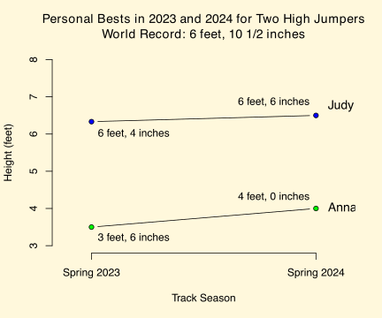{width="100%" fig-alt="Line chart titled Personal Bests in 2023 and 2024 for Two High Jumpers (world record 6 feet, 10 1/2 inches). Judy's personal best rises from 6 feet, 4 inches in spring 2023 to 6 feet, 6 inches in spring 2024; Anna's rises from 3 feet, 6 inches to 4 feet, 0 inches."}
:::
::::

## Joint Distribution of 2024 and 2025 Scale Scores {.figure-slide}

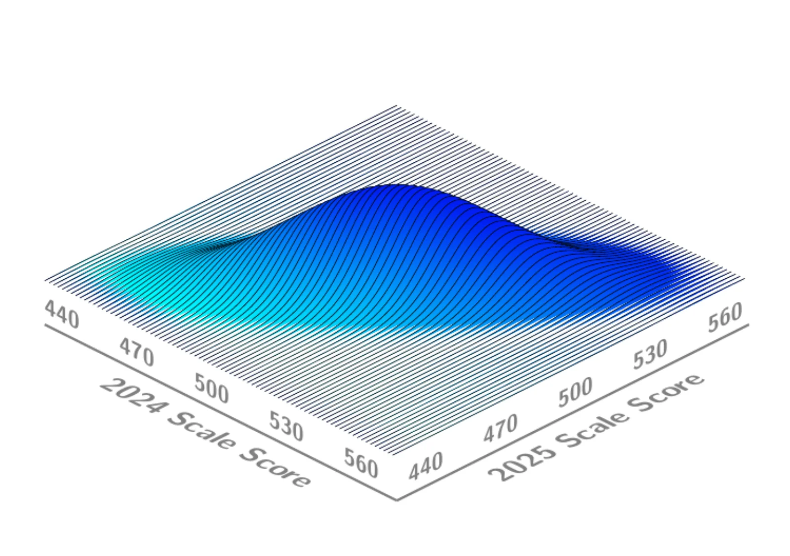{fig-alt="Three-dimensional surface plot of the joint density of students' 2024 and 2025 scale scores, each axis running from about 440 to 560. The density forms a single ridge along the diagonal: students with higher 2024 scores tend to have higher 2025 scores."}

## Conditioning on a 2024 Scale Score {.figure-slide}

{fig-alt="The same joint density surface cut by a pink vertical plane at a single 2024 scale score; the slice, shaded red, is the distribution of 2025 scale scores for students who share that prior score."}

## Locating a Student's 2025 Score {.figure-slide}

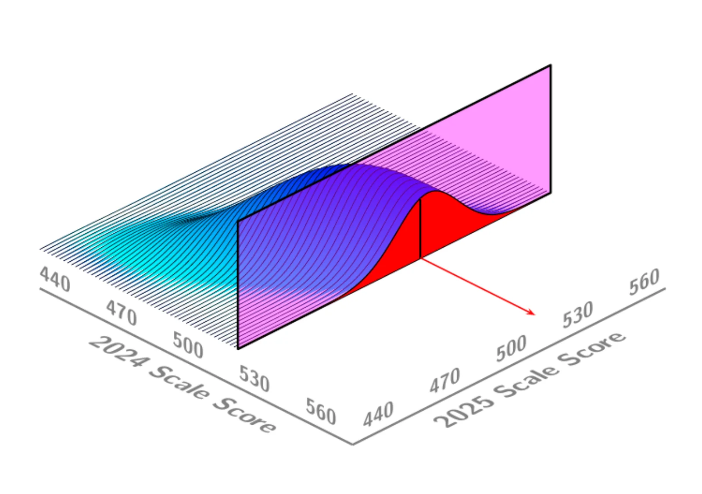{fig-alt="A vertical line marks one student's 2025 scale score on the red conditional distribution, with an arrow pointing to that score on the 2025 axis."}

## 40th Percentile Growth {.figure-slide}

{fig-alt="The area of the conditional distribution below the student's 2025 score is labeled 40%: the student's score exceeds 40 percent of students with the same 2024 score, which is 40th percentile growth."}

## 75th Percentile Growth {.figure-slide}

{fig-alt="With a higher 2025 score, the shaded area below the student's score is labeled 75%: the student's score exceeds 75 percent of students with the same 2024 score, which is 75th percentile growth."}

## Academic Peers {.figure-slide}

{fig-alt="The plane is labeled Academic Peers with the 2024 scale score that defines the group; the shaded 75% area marks 75th percentile growth relative to those academic peers."}

## Academic Peers: 2024 Scale Score = 520 {.figure-slide}

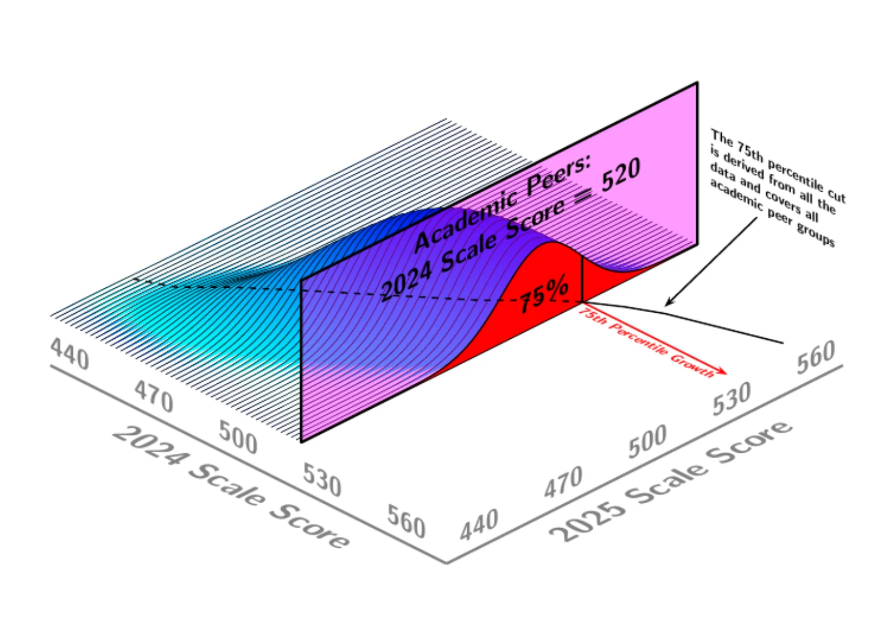{fig-alt="For academic peers with a 2024 scale score of 520, the 75th percentile cut is marked on the conditional distribution. A dashed curve carries that cut across the surface, and a note explains that the 75th percentile cut is derived from all the data and covers all academic peer groups."}

## Academic Peers: 2024 Scale Score = 475 {.figure-slide}

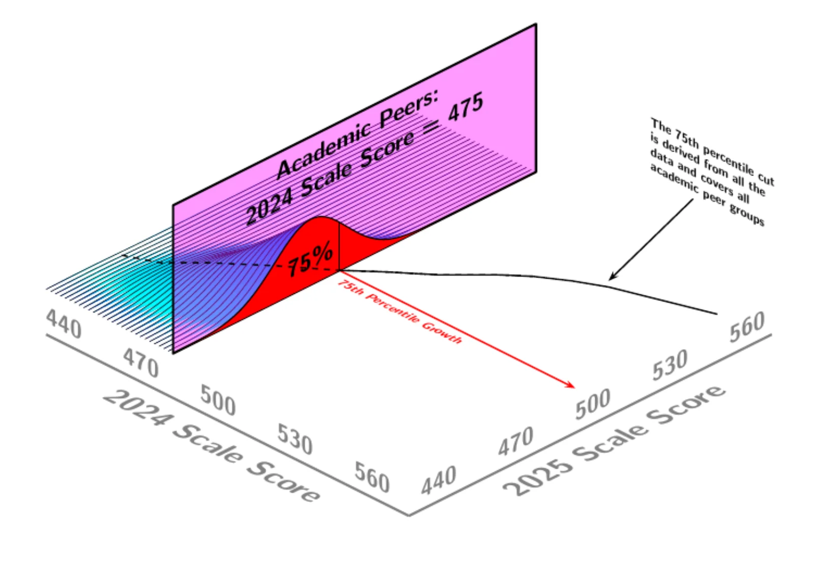{fig-alt="The same view for academic peers with a 2024 scale score of 475: the 75% area and the 75th percentile cut sit lower on the 2025 axis, on the same dashed curve that covers all academic peer groups."}

## The 75th Percentile Across Academic Peer Groups {.figure-slide}

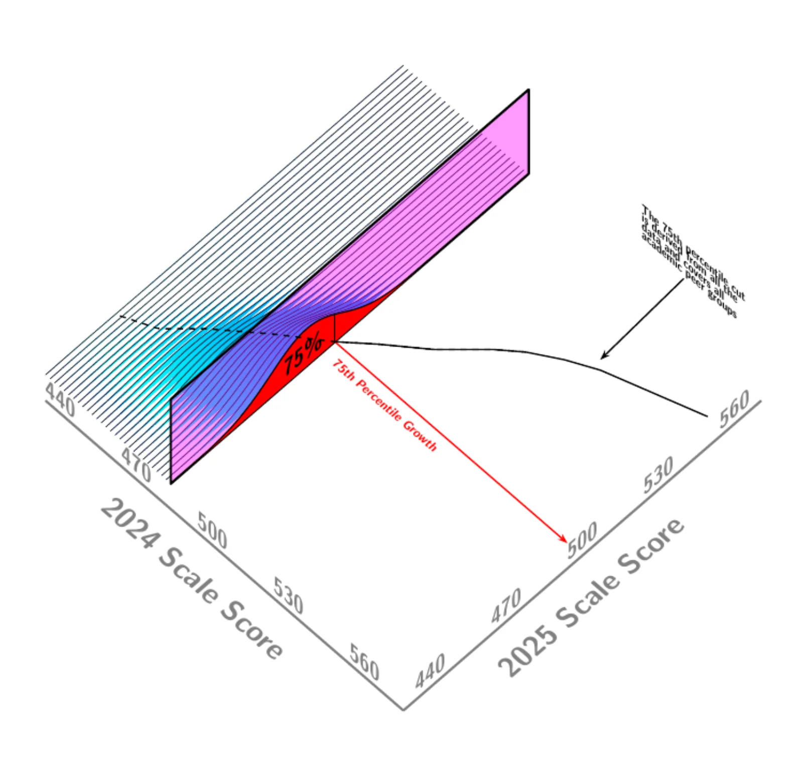{fig-alt="The surface rotated so the 2024 scale score axis runs toward the viewer, showing the 75th percentile curve traced across all 2024 scale scores, with the note that the cut is derived from all the data and covers all academic peer groups."}

## The 75th Percentile Across Academic Peer Groups {.figure-slide}

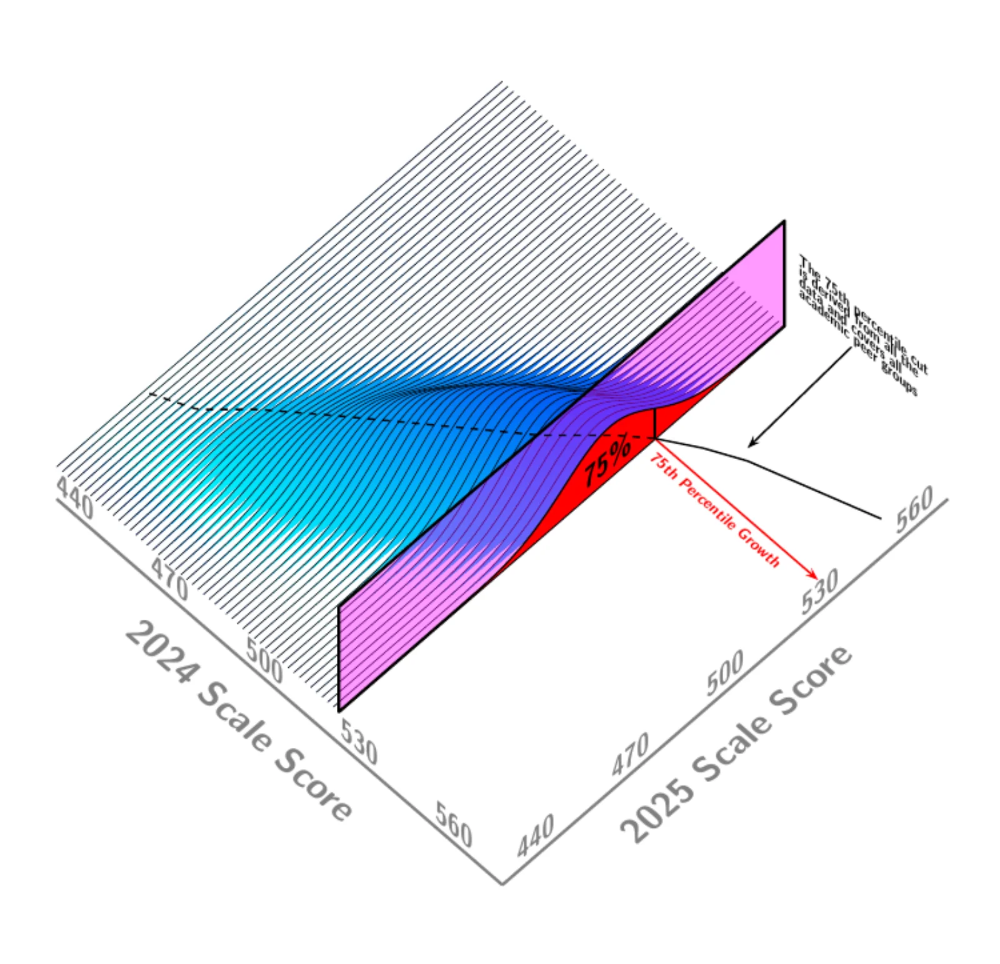{fig-alt="A second rotated view of the full density surface with the 75th percentile curve running across every 2024 scale score, linking the percentile cut for each group of academic peers."}

## Student Growth Percentiles

**[Should we be surprised with a child's current achievement given their prior achievement?]{.accent}**

-   Given a student's prior scale scores and the associated conditional density, their current scale score corresponds to a percentile of that conditional distribution.

-   This percentile is the **[student's growth percentile]{.accent}**.

-   Growth percentiles are closely related to estimating the probability of observing a student's current achievement taking account of their past achievement:

    $$
    \Pr(Current~Achievement | Past~Achievement).
    $$ {#eq-condprob}

-   As such, growth percentiles describe the rarity of a student's current achievement conditional upon their prior achievement.

## Student Growth Percentiles

**[Should we be surprised with a child's current achievement given their prior achievement?]{.accent}**

-   Student growth percentiles answer this question.

-   Consider a low achieving student with 90th percentile growth and a high achieving student with 10th percentile growth.

    -   The low achieving student grew at a rate exceeding 90 percent of similar students.

    -   The high achieving student grew at a rate exceeding just 10 percent of similar students.

    -   The low achiever's growth is more *exemplary* (probabilistically) than the high achiever's.

-   Judgments about the **[adequacy]{.accent}** of student growth require external criteria.

## Model for Student Growth Percentiles

-   Student growth percentiles are calculated using quantile regression with B-spline smoothing, a generalized additive model.

-   Quantile regression is used to model the complete distribution of the response variable (current achievement)

-   B-spline smoothing is uses to accommodate non-linearity and heteroscedasticity of the data.

-   The model/method is descriptive and all about data fit---it's a data mining procedure.

-   The model quantifies $distance = rate \cdot time$ probabilistically.

## Model for Student Growth Percentiles

:::: {layout-ncol=2}
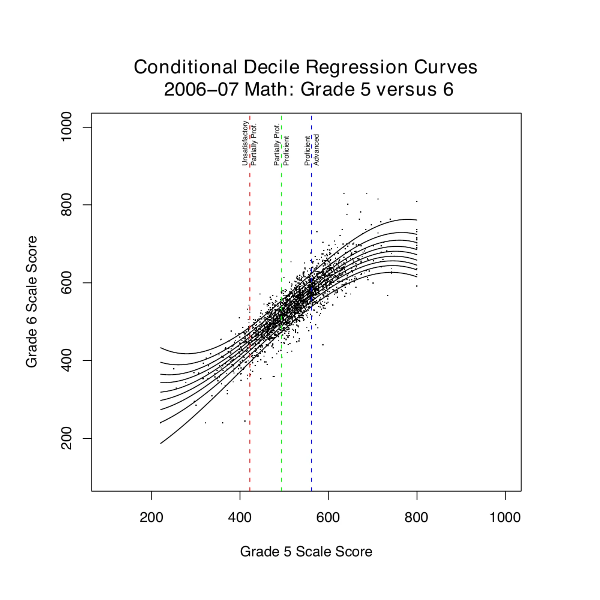{fig-alt="Scatterplot of grade 6 against grade 5 math scale scores for 2006–07 with conditional decile regression curves fitted using B-splines: the curves bend and spread apart at the low and high ends of the grade 5 scale. Dashed vertical lines mark the grade 5 achievement level cuts."}

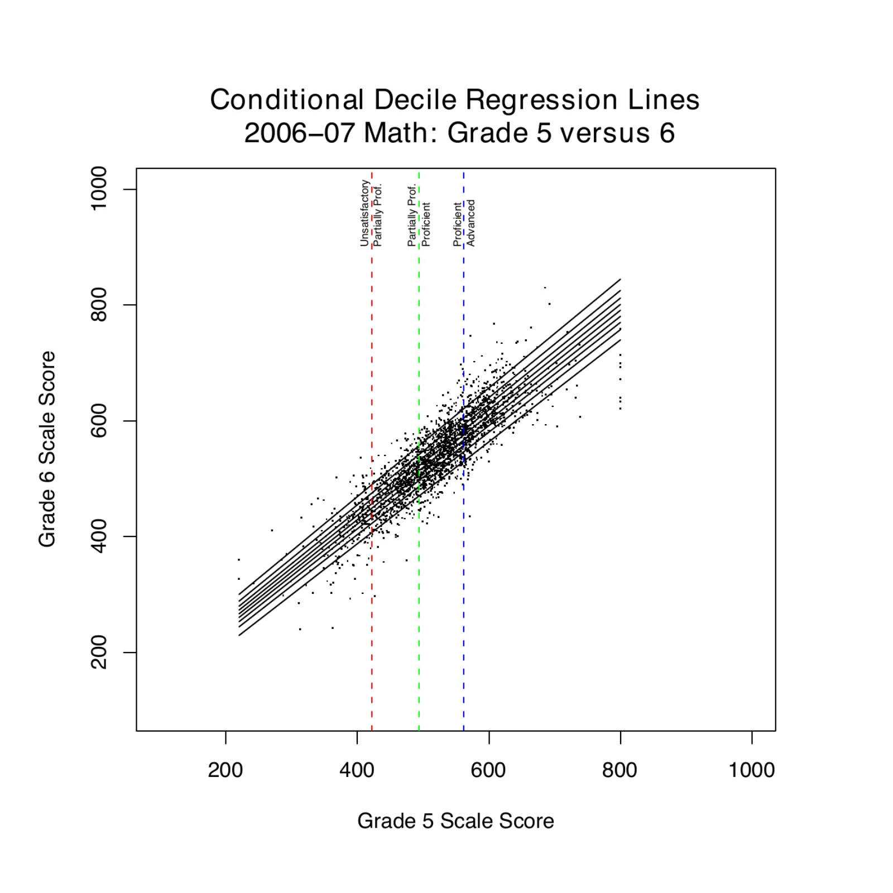{fig-alt="The same 2006–07 grade 5 versus grade 6 math scatterplot with conditional decile regression lines fitted as straight lines: the lines are parallel and evenly spaced, missing the curvature and changing spread visible in the B-spline version."}
::::

## Establishing growth-standards based upon growth-norms

-   The most common adequacy criterion are judging growth toward an achievement goal like proficiency, English Language master (i.e., growth-to-standard).

-   Results from student growth percentile analyses can be used to calculate percentile growth trajectories for each student.

-   These trajectories indicate what future rates of growth will lead to and are used to make adequacy judgments.

-   This growth-to-standard approach was approved as part of Colorado's successful application to the Growth Model Pilot Program.

-   Growth-to-standard is most often used for English Language Proficiency testing (e.g., WIDA-ACCESS in Massachusetts)

## Demonstration Student Growth and Achievement Report {.figure-slide}

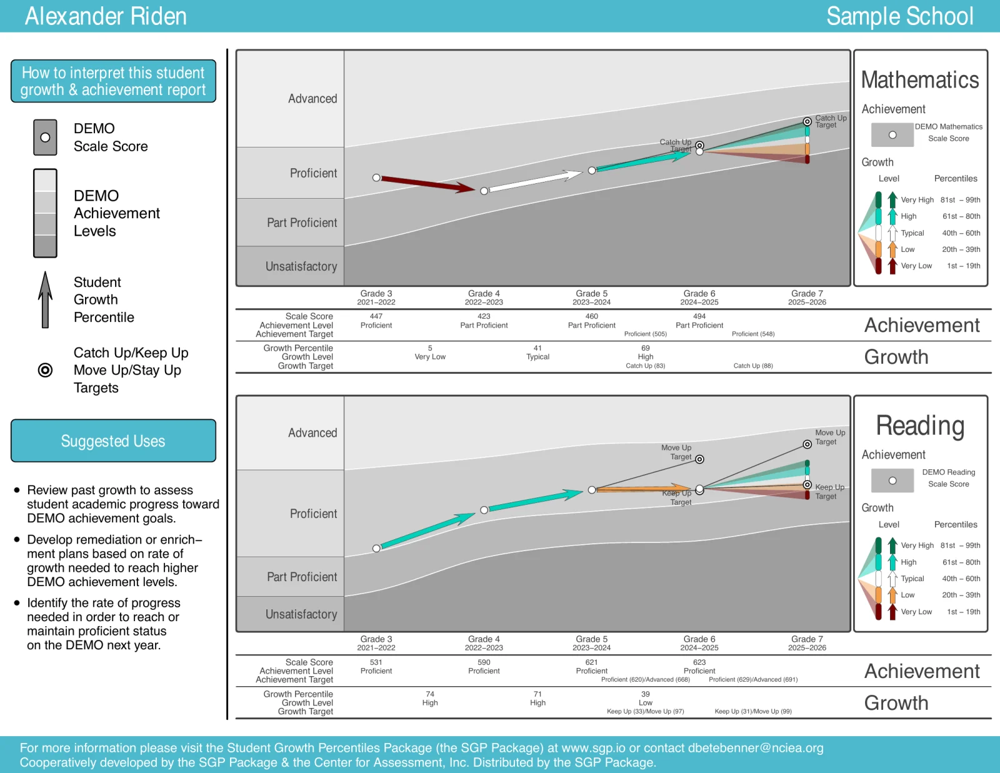{fig-alt="Demonstration individual student growth and achievement report for a fictitious student at Sample School on the DEMO assessment, grades 3 to 7 (2021–2022 to 2025–2026). In Mathematics, scale scores 447, 423, 460 and 494 move between Proficient and Part Proficient with growth percentiles of 5 (Very Low), 41 (Typical) and 69 (High) and catch-up targets; in Reading, scale scores 531, 590, 621 and 623 stay Proficient with growth percentiles of 74 (High), 71 (High) and 39 (Low) and keep-up and move-up targets. A sidebar explains how to read the report and lists suggested uses."}

## Demonstration: 2024–2025 Mathematics Growth & Achievement {.figure-slide}

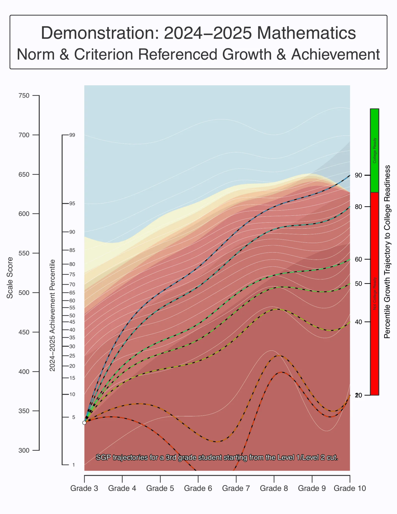{fig-align="center" fig-alt="Demonstration 2024–2025 Mathematics norm and criterion referenced growth and achievement chart, grades 3 to 10. SGP trajectories for a 3rd grade student starting from the Level 1/Level 2 cut fan out across shaded achievement bands, and a bar on the right splits the percentile growth trajectories into College Ready (green, at the top) and Not College Ready (red); only the highest trajectories reach the College Ready range."}

## Going from Students to Schools

-   It's of interest to examine schools where students demonstrate, on average, extraordinarily high and low student growth.

-   To summarize the student growth percentiles associated with a school (or other grouping) calculate the median of the student growth percentiles.

-   If students were randomly assigned to schools, expect to see a median of 50.

-   Values greatly above or below 50 are of interest in identifying best practices or providing extra support.

-   Examining growth with achievement sheds new light on school performance.

## DEMO Growth & Prior Achievement: Mathematics {.figure-slide}

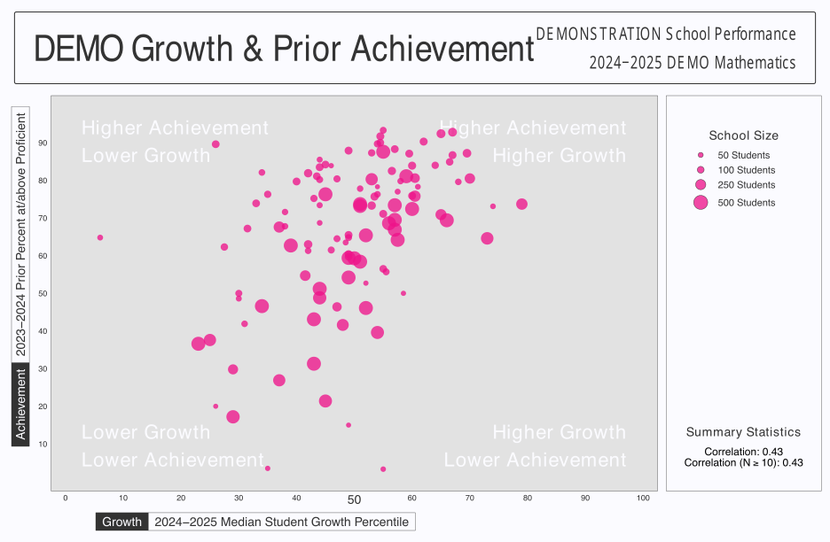{fig-align="center" fig-alt="Demonstration bubble plot of schools for 2024–2025 DEMO Mathematics: median student growth percentile on the horizontal axis against 2023–2024 prior percent at/above proficient on the vertical axis, with bubble size showing school size. Schools with higher prior achievement tend to show higher growth (correlation 0.43), but schools spread into all four quadrants."}

## DEMO Growth & Prior Achievement: Reading {.figure-slide}

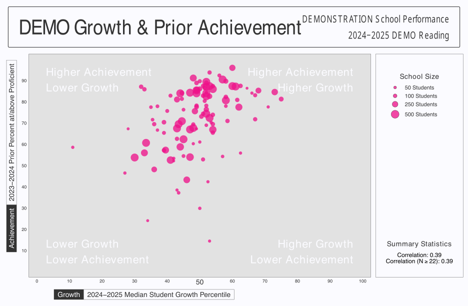{fig-align="center" fig-alt="Demonstration bubble plot of schools for 2024–2025 DEMO Reading: median student growth percentile against 2023–2024 prior percent at/above proficient, bubble size showing school size. Growth and prior achievement are moderately related (correlation 0.39)."}

## DEMO Growth & Achievement: Mathematics {.figure-slide}

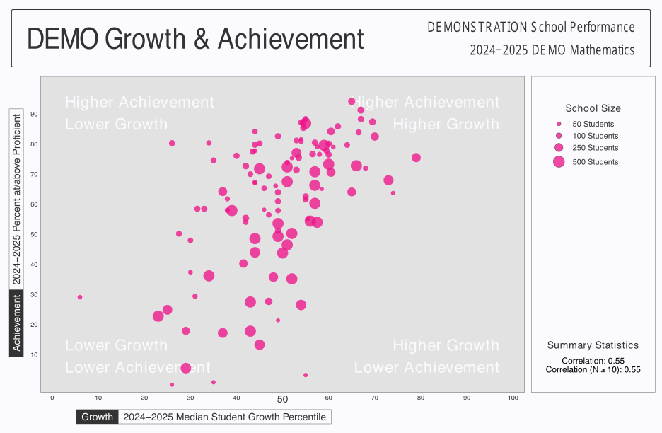{fig-align="center" fig-alt="Demonstration bubble plot of schools for 2024–2025 DEMO Mathematics: median student growth percentile against 2024–2025 percent at/above proficient, bubble size showing school size. Growth is more strongly related to current achievement (correlation 0.55) than to prior achievement."}

## DEMO Growth & Achievement: Reading {.figure-slide}

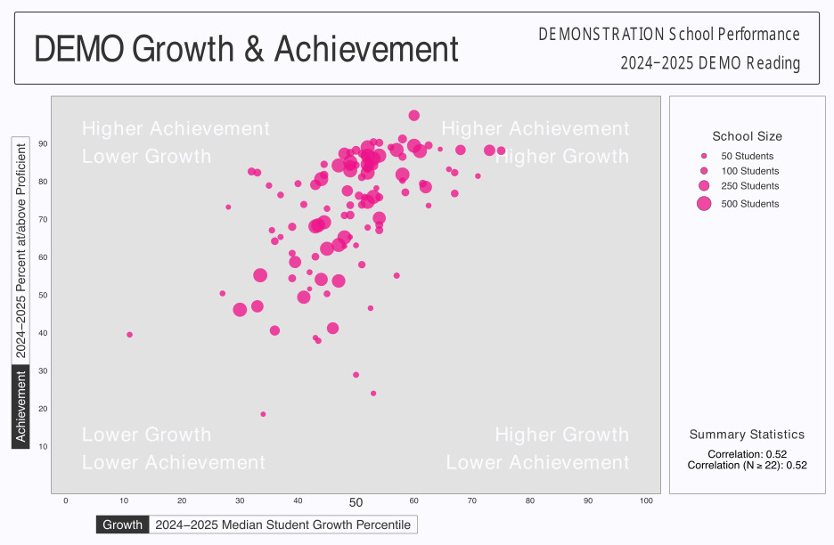{fig-align="center" fig-alt="Demonstration bubble plot of schools for 2024–2025 DEMO Reading: median student growth percentile against 2024–2025 percent at/above proficient, bubble size showing school size. Growth is more strongly related to current achievement (correlation 0.52) than to prior achievement."}

## References {.smaller .scrollable}

::: {#refs}
:::

